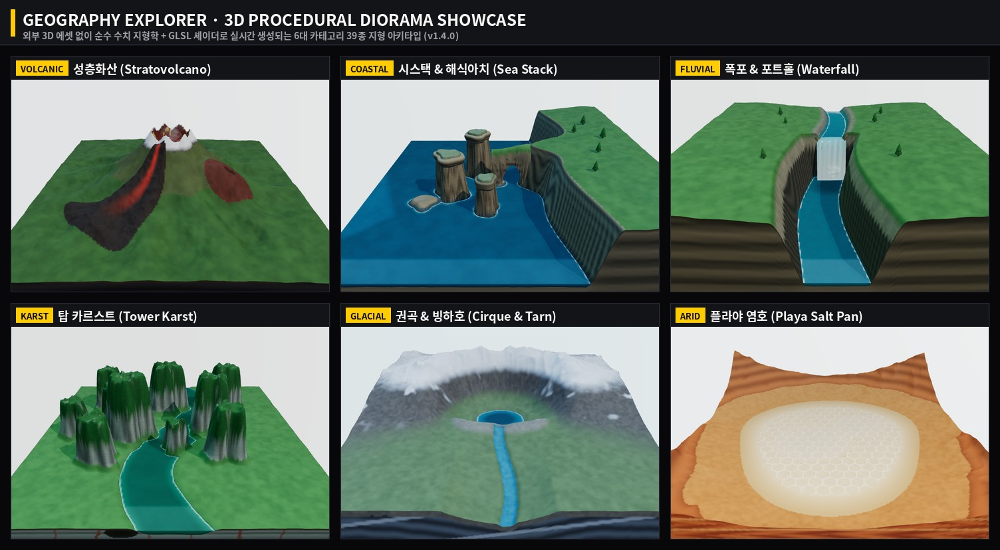
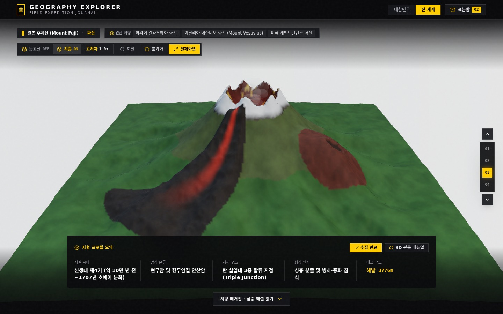
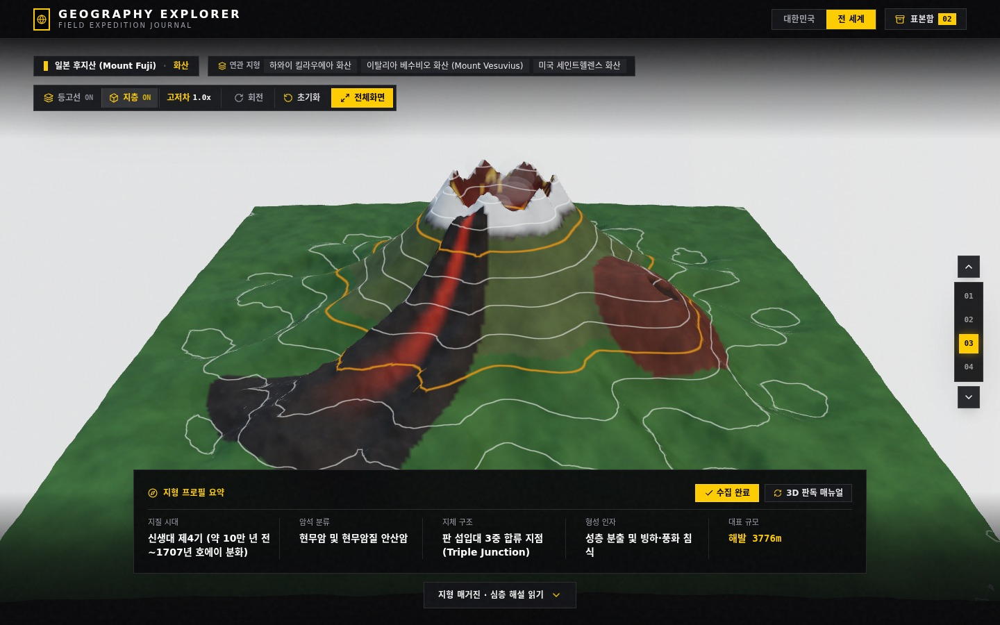
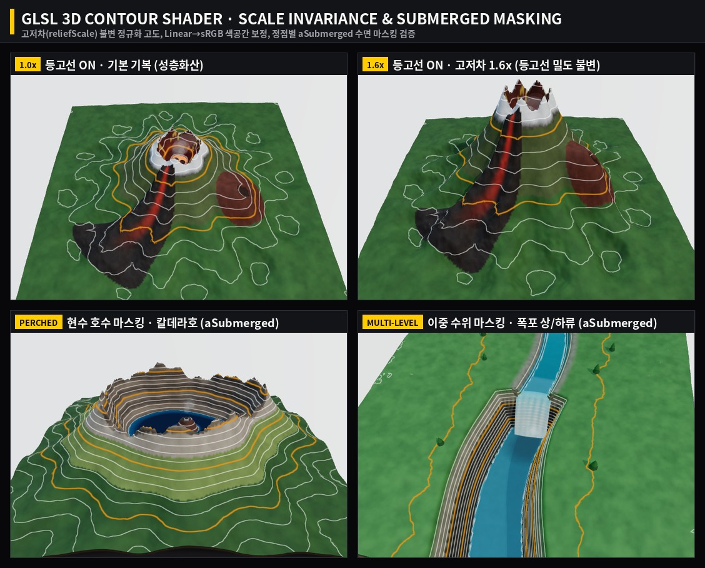

# 🌍 지형 탐험가 (Geography Explorer)

> **전 세계와 대한민국의 165개 지질 명소를 내셔널 지오그래픽 에디토리얼 다크(NatGeo Editorial Dark) UI, 4단 풀스크린 스냅 슬라이드, 240×240 고해상도 절차적 3D 디오라마, 실시간 GLSL 3D 등고선·지질 단면 시각화, 고해상도 위성지도, 그리고 다크/페이퍼 지형 매거진(4단계 교육과정 난이도 전환)으로 입체 탐구하는 차세대 지리·지구과학 웹 플랫폼**

[](https://react.dev/)
[](https://www.typescriptlang.org/)
[](https://threejs.org/)
[](https://tailwindcss.com/)
[](https://vitejs.dev/)
[](CHANGELOG.md)
[](LICENSE)



---

## 📌 1. 프로젝트 개요 (Overview)

**지형 탐험가 (Geography Explorer)**는 2차원 교과서 삽화와 평면 사진만으로는 체감하기 어려웠던 지형의 고저차, 지하 지질 단면, 형성 연대기, 공간적 규모를 **0px 직각 에디토리얼 아카이브 UI** 위에서 입체적으로 탐구할 수 있도록 설계된 100% 클라이언트 사이드 인터랙티브 지구과학 웹 플랫폼입니다.

화산·산지, 해안, 하천, 카르스트, 빙하, 건조의 **6대 대분류**, **34개 UI 지형 태그**, **39종 고유 지오메트리 3D 아키타입**, 그리고 **총 165개(전 세계 86개소, 대한민국 79개소) 지질 명소 데이터베이스**와 **165/165 장소별 실경 사진 매핑**을 탑재했습니다. 모든 명소(165/165)와 모든 3D 아키타입(39/39)이 UI에서 100% 도달 가능하며, 외부 3D 모델이나 HDRI CDN 의존성 없이 오프라인 환경에서도 완벽하게 구동됩니다.

### 🎨 NatGeo Editorial Dark Design System
- **Strict 0px Architectural Geometry**: 전역 `border-radius: 0px !important` 직각 규율, `1px` 헤어라인 그리드(`.hairline-border`), 매거진 프레임(`.magazine-frame`), 드롭캡 타이포그래피(`.magazine-drop-cap`) 적용.
- **Editorial Dark & Paper Dual Palette**:
  - 다크 에디토리얼: Obsidian(`#08080A`), Slate Surface(`#131418`), NatGeo Signature Yellow(`#FFCC00`), Amber(`#E5B800`), Warm Ivory(`#EDE9E0`).
  - 슬라이드 04 페이퍼 매거진 모드: Editorial Paper(`#F6F3EC`), Editorial Ink(`#181715`).
- **Fluid Motion & Micro-Interactions**: 4차 이징 스냅 스크롤(`useSlideNavigation`), 마우스 추적 위상 조리개 캔버스(`HeroApertureCanvas`), 스프링 물리 오도미터 카운터(`OdometerCounter`), 표본 수집 아카이브 서랍(`SpecimenDrawer`), 180° Y축 3D 플립 매뉴얼 카드.

---

## 🖼️ 2. 주요 화면 프리뷰 (Live UI Screenshots)

### SLIDE 03 · 3D 입체 지형 디오라마 & 실시간 GLSL 등고선 오버레이

| 3D 입체 지형 디오라마 (일본 후지산 성층화산) | 실시간 GLSL 3D 등고선 오버레이 (`등고선 ON`) |
|:---:|:---:|
|  |  |

### SLIDE 04 · 지형 매거진 (페이퍼 모드 · 4단계 교육과정) & 표본 수집 아카이브

| 지형 매거진 페이퍼 모드 (`초등` 난이도 & 현장 도감) | 표본 수집 아카이브 서랍 (`SpecimenDrawer`) |
|:---:|:---:|
|  |  |

---

## 🧭 3. 4단 풀스크린 스냅 슬라이드 구조 (4-Act Architecture)

고정 마스트헤드(`56px`) 아래 `calc(100vh - 56px)` 규격의 4개 액트(`01`~`04`)가 CSS Scroll Snap, 부드러운 4차 이징 스크롤([`useSlideNavigation`](src/hooks/useSlideNavigation.ts)), 그리고 우측 플로팅 챕터 독([`SlideNavigationDock`](src/components/SlideNavigationDock.tsx))으로 동기화됩니다.

1. **SLIDE 01 · 메인 커버 ([`HeroSlideshow.tsx`](src/components/HeroSlideshow.tsx))**:
   - 시네마틱 크로스페이드 배경 전환과 마우스 포인터 추적 위상 조리개 캔버스([`HeroApertureCanvas`](src/components/kinetic/HeroApertureCanvas.tsx)) 결합.
   - 6대 대분류 6초 자동/수동 캐러셀 및 상단 헤더(`[ 대한민국 ]` 79개소 · `[ 전 세계 ]` 86개소) 권역 전환.
   - **34개 UI 지형 태그** 원클릭 시 대표 명소가 매칭되며 `SLIDE 02` 위성지도로 부드럽게 이동.
2. **SLIDE 02 · 구글 위성지도 ([`GoogleMapSlide.tsx`](src/components/slides/GoogleMapSlide.tsx))**:
   - Google Satellite 위성 뷰(`t=k&z=13`)를 100% 뷰포트로 렌더링하고, `[ 위성 지도 직접 조작하기 ]` 버튼으로 스냅 스크롤과 지도 줌·팬 조작을 충돌 없이 전환.
   - NatGeo 옐로우 상단 바 에디토리얼 플래카드에서 형성 원리, 탐사 메타데이터, 외부 지도(`Google Maps`, `Google Earth 3D`, 한국 `Naver Map`), 연관 지형 전환 및 표본 수집 지원.
3. **SLIDE 03 · 3D 입체 지형 ([`Terrain3DSlide.tsx`](src/components/slides/Terrain3DSlide.tsx) · [`Terrain3D.tsx`](src/components/Terrain3D.tsx))**:
   - 단일 영속 WebGL `<Canvas shadows="percentage" dpr={[1, 2]}>` 인스턴스를 인라인/전체화면(`ESC` 종료) 모드가 공유하며, 비활성 슬라이드 시 `frameloop="demand"`로 GPU 부하 자동 절감.
   - **240×240 적응형 고밀도 메쉬** + **GLSL 골드/화이트 등고선 셰이더** + **28층 지질 단면 스커트** + **고저차 배율(`1.0x → 1.3x → 1.6x`)** + **오프라인 4방향 `<Lightformer>` IBL**.
   - **모듈화 특수 3D 메쉬 (`src/components/terrain/meshes/*`)**: 35종 아키타입 전용 수면·용암·폭포·주상절리·전면 절개 동굴·해식아치·버섯바위·식생 결합.
   - **하단 180° Y축 3D 플립 카드**: 앞면 지질 프로필 요약 ↔ 뒷면 3대 3D 시각 판독 매뉴얼 전환.
4. **SLIDE 04 · 지형 매거진 ([`GeologicalGuideSlide.tsx`](src/components/slides/GeologicalGuideSlide.tsx) · `guide/*`)**:
   - 상단 2px 읽기 진행률 바 + **스티키 매거진 리더 바(`GuideStickyBar`)**: 4대 섹션 목차 앵커(`서문 · 형성과정 · 심층해설 · 현장도감`), **4단계 교육과정 난이도 전환(`초등` / `중등` / `고등` / `일반`)**, **다크 ↔ 페이퍼 모드(`#F6F3EC`)** 실시간 전환, 표본 수집.
   - 전 165개소 실제 경관 사진(`src/constants/placeImages.ts`), `PART I` 4단계 형성 연대기 확장 카드, `PART II` 핵심 지형학 개념 3선, `PART III` GFM 심층 보고서, 우측 스티키 `FIELD DOSSIER`(팩트시트·현장 관찰·위성 판독·안전 수칙).

---

## 🔬 4. v1.4.0 3D 렌더링 및 GLSL 셰이더 하이라이트



- **39종 전수 DEM 무결성 (Zero Spikes)**: 모든 아키타입의 사면·절벽·경계면을 유한 경사 전환으로 정비해 고도 이상치 0건, 수중 식생 배치 0건, 39/39 아키타입 및 165/165 명소 100% UI 도달을 달성했습니다.
- **고저차 불변(`reliefScale`-invariant) & 색공간 보정 GLSL 등고선**: `elev = z / reliefScale` 정규화로 고저차 배율을 `1.0x → 1.6x`로 바꿔도 등고선 밀도가 유지되며, Linear→sRGB 변환으로 선명한 골드 계곡선과 화이트 주곡선을 렌더링합니다.
- **정점별 `aSubmerged` 전역 수면 마스킹**: 해수면뿐 아니라 칼데라호, 권곡 빙하호, 폭포 상·하류 이중 수위, U자곡 현곡 하천, 모레인 빙하호, 오아시스, 플라야 염호, 석회동굴 지하하천, 파식대 조수웅덩이까지 모든 수면 아래 등고선을 정확히 차단합니다.
- **100% 오프라인 프로시저럴 IBL & 주기적 심리스 텍스처**: 외부 CDN HDRI 의존성을 제거하고 `<Environment resolution={256} frames={1}>` + `<Lightformer>` 조명 리그와 주기적 심리스 캔버스 범프 텍스처를 적용했습니다.

---

## 🛠️ 5. 기술 스택 (Tech Stack)

| 계층 | 주요 기술 및 패키지 | 비고 |
|:---|:---|:---|
| **Core** | React 19.0, TypeScript 5.8, Vite 6.2 | Strict Type Check (`tsc --noEmit`), Rollup `manualChunks` 청크 분리 |
| **3D Engine** | Three.js 0.183, React Three Fiber v9, Drei v10 | `shadows="percentage"` (`PCFShadowMap`), 오프라인 `<Lightformer>` IBL, LRU 캐시(Geometry 24 / DEM 20) |
| **Shaders & Procedural** | Custom GLSL (`onBeforeCompile`), FBM, Warping, Voronoi | Triplanar 절벽 층리, Cavity AO, `reliefScale` 불변 등고선, `aSubmerged` 전역 수면 마스킹 |
| **UI & Motion** | Tailwind CSS v4, `@tailwindcss/typography`, Motion v12, Lucide React | NatGeo Editorial Dark/Paper 듀얼 테마, `0px` 직각 규율, 4차 이징 스냅 스크롤 |
| **Content** | `react-markdown`, `remark-gfm` | 165개 명소 데이터 + 165장 Wikimedia 실경 사진 + 4단계 교육과정 변환 엔진 |

---

## 📁 6. 프로젝트 구조 (Project Structure)

```text
├── docs/                                  # 📚 기술·시각 가이드 문서 및 검증 스크린샷 에셋
│   ├── assets/                            # UI 실구동 스크린샷, GLSL 검증 & 6대 범주 39종 3D 카탈로그 시트
│   ├── ARCHITECTURE.md                    # 시스템 아키텍처, 3D/GLSL 파이프라인 및 LRU·GPU 최적화 전략
│   ├── SLIDE_VISUAL_GUIDE.md              # 4-Act 슬라이드 화면 구조, 표본 서랍 & 3D/매거진 조작 매뉴얼
│   └── TERRAIN_CATALOG.md                 # 6대 범주 34태그·39종 아키타입 & 165개 지질 명소 전수 카탈로그
├── .github/                               # 🤝 이슈/PR 템플릿
├── src/
│   ├── components/
│   │   ├── Navigation.tsx                 # 56px NatGeo 마스트헤드, 권역 스위처 & 표본함 오도미터 버튼
│   │   ├── SlideNavigationDock.tsx        # 우측 01~04 챕터 플로팅 독 & 키보드(↑/↓) 네비게이션
│   │   ├── HeroSlideshow.tsx              # SLIDE 01: 6대 범주 시네마틱 커버 & 34개 UI 지형 태그
│   │   ├── Terrain3D.tsx                  # R3F Canvas, 오프라인 Lightformer IBL, PCFShadowMap, 등고선 셰이더
│   │   ├── LoadingOverlay.tsx             # 지형 데이터 전환 오버레이
│   │   ├── ErrorMessage.tsx               # 시스템 알림 토스트
│   │   ├── common/                        # 공용 UI 모듈 (AlternativePlacesBar, SpecimenCollectButton)
│   │   ├── kinetic/                       # FilmGrainOverlay, HeroApertureCanvas, OdometerCounter, SpecimenDrawer
│   │   ├── slides/
│   │   │   ├── GoogleMapSlide.tsx         # SLIDE 02: 100vh 위성 지도 & 직접 조작 락 토글
│   │   │   ├── Terrain3DSlide.tsx         # SLIDE 03: 단일 3D 스테이지, HUD & 180° Y축 플립 카드
│   │   │   ├── GeologicalGuideSlide.tsx   # SLIDE 04: 다크/페이퍼 지형 매거진 & 4단계 난이도 스위처
│   │   │   └── guide/                     # GuideStickyBar, GuideTimelineSection, GuideFieldDossier, guideTheme
│   │   └── terrain/                       # 3D 절차적 지형 생성 및 셰이더 엔진
│   │       ├── terrainMath.ts             # FBM, Domain Warping, Hexagonal Voronoi 핵심 수학 엔진
│   │       ├── terrainEvaluator.ts        # 6대 카테고리 평가기 통합 디스패처
│   │       ├── terrainGenerators.ts       # 240×240 지오메트리, getLocalWaterElevation, LRU GEOMETRY_CACHE(24)
│   │       ├── terrainTextures.ts         # 주기적 심리스 프로시저럴 범프 텍스처 생성기
│   │       ├── TerrainSpecialMeshes.tsx   # 35종 특수 메쉬 매핑 레지스트리
│   │       ├── meshes/                    # shared + 6대 범주별 특수 메쉬 모듈 (useDisposeGeometry 관리)
│   │       ├── generators/                # 6대 범주별 절차적 고도·색상 평가기
│   │       └── contour/                   # GLSL 셰이더 인젝션, LRU DEM_CACHE(20), 등고선 간격 규격
│   ├── constants/
│   │   ├── terrainRegistry.ts             # 지형 키·별칭·카테고리·기준 수위 단일 진실 원천(SSOT)
│   │   ├── terrains.ts                    # 6대 대분류 & 34개 UI 지형 태그 마스터
│   │   ├── places.ts                      # 165개 명소 검색, matchesTerrainFilter, 중복 방지 셔플
│   │   ├── placeImages.ts                 # 165개 명소별 Wikimedia Commons 실경 사진 매핑
│   │   └── places/                        # 6대 카테고리 165개 명소 데이터 (33/25/25/31/18/33)
│   ├── hooks/                             # useTerrainSearch, useSlideNavigation, useSpecimenBag
│   ├── utils/                             # curriculumHelper, educationLevelHelper, terrainConceptData
│   ├── types/                             # index.ts, contour.ts
│   ├── App.tsx                            # 최상위 4단 스냅 레이아웃 & 표본/탐색 오케스트레이터
│   ├── main.tsx                           # React 엔트리포인트
│   └── index.css                          # Tailwind CSS v4 & NatGeo Editorial Dark/Paper 유틸리티
├── CHANGELOG.md
├── CONTRIBUTING.md
├── CODE_OF_CONDUCT.md
├── SECURITY.md
├── package.json
├── tsconfig.json
├── vite.config.ts
└── LICENSE
```

---

## 🚀 7. 빠른 시작 (Getting Started)

### 사전 요구 사항
- **Node.js**: v20.18.0 이상 (v22+ / v24+ 권장)
- **npm**: v10 이상

### 설치 및 실행
```bash
# 1. 의존성 패키지 설치
npm install

# 2. 로컬 개발 서버 구동 (http://localhost:3000)
npm run dev

# 3. TypeScript 정적 타입 검사 & 프로덕션 빌드
npm run lint
npm run build
```

---

## 📚 8. 상세 문서 안내 (Documentation Index)

- 🏗️ **[시스템 아키텍처 (docs/ARCHITECTURE.md)](docs/ARCHITECTURE.md)**: NatGeo 4-Act 구조, `terrainRegistry` SSOT, 240×240 절차적 3D 파이프라인, 오프라인 IBL·GLSL 셰이더, LRU 캐시 및 GPU 최적화 전략.
- 📖 **[4단 슬라이드 시각화 가이드 (docs/SLIDE_VISUAL_GUIDE.md)](docs/SLIDE_VISUAL_GUIDE.md)**: SLIDE 01~04 화면 구조, 표본 아카이브(`SpecimenDrawer`), 3D 플립 카드 및 다크/페이퍼 매거진 실구동 스크린샷 가이드.
- 🌍 **[지형 총람 및 165개 지질 명소 카탈로그 (docs/TERRAIN_CATALOG.md)](docs/TERRAIN_CATALOG.md)**: 6대 대분류 34태그, 39종 3D 아키타입 전수 카탈로그 시트 및 검증된 165개 명소(전 세계 86 / 대한민국 79) 목록.
- 📋 **[변경 이력 (CHANGELOG.md)](CHANGELOG.md)** · 🤝 **[기여 가이드 (CONTRIBUTING.md)](CONTRIBUTING.md)** · 🛡️ **[행동 강령 (CODE_OF_CONDUCT.md)](CODE_OF_CONDUCT.md)** · 🔒 **[보안 정책 (SECURITY.md)](SECURITY.md)**

---

## 📄 9. 라이선스 (License)

본 프로젝트는 **[MIT 라이선스](LICENSE)**에 따라 오픈소스로 배포됩니다.
