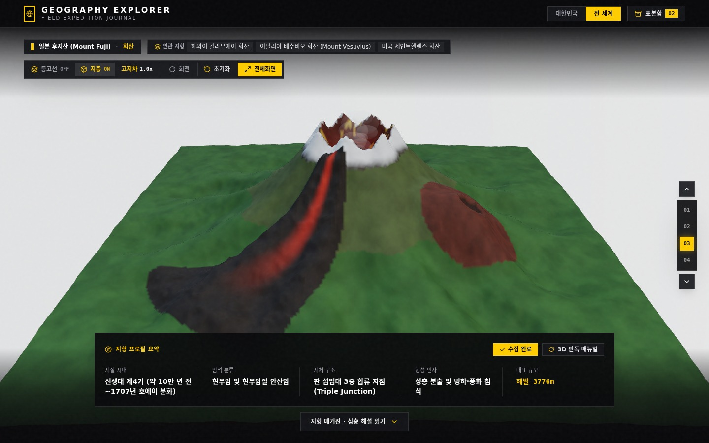
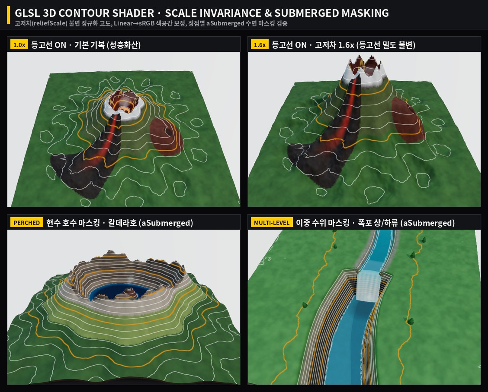

# 🏗️ 지형 탐험가(Geography Explorer) 시스템 아키텍처 (v1.4.0)

지형 탐험가는 **React 19**, **Three.js 0.183**, **React Three Fiber(R3F) v9**, **TypeScript 5.8**, **Tailwind CSS v4**, **Motion v12**를 기반으로 구축된 100% 클라이언트 사이드 인터랙티브 지리·지구과학 탐구 웹 플랫폼입니다.  
본 문서는 **NatGeo Editorial Dark** 4-Act 레이아웃, 부드러운 이징 스냅 스크롤 및 표본 아카이브 상태 흐름, 단일 진실 원천(`terrainRegistry.ts`) 기반 39종 절차적 3D 디오라마 파이프라인, 오프라인 프로시저럴 IBL 및 GLSL 등고선 셰이더 인젝션, 그리고 LRU 캐시·GPU 자원 최적화 아키텍처를 설명합니다.

---

## 1. 전체 시스템 아키텍처 다이어그램

```text
┌────────────────────────────────────────────────────────────────────────────────────────┐
│                           GEOGRAPHY EXPLORER ENGINE (v1.4.0)                           │
└───────────────────────────────────────────┬────────────────────────────────────────────┘
                                            │
        ┌───────────────────────────────────┴───────────────────────────────────┐
        ▼                                                                       ▼
┌──────────────────────────────────┐                   ┌─────────────────────────────────────────┐
│     Custom Hooks & State         │                   │         SSOT Data & Procedural Core     │
├──────────────────────────────────┤                   ├─────────────────────────────────────────┤
│ • useTerrainSearch.ts            │                   │ • constants/terrainRegistry.ts (SSOT)   │
│   (검색·ID 복원·후보 전환)       │                   │ • constants/terrains.ts (6범주·34태그)  │
│ • useSlideNavigation.ts          │                   │ • constants/places/*.ts (165개 명소)    │
│   (이징 스크롤·IO 0.55 추적)     │                   │ • constants/placeImages.ts (165 실경)   │
│ • useSpecimenBag.ts              │                   │ • educationLevelHelper + terrainConcept │
│   (localStorage v1 표본 영속화)  │                   │ • terrainMath.ts · terrainEvaluator.ts  │
└─────────────────┬────────────────┘                   └────────────────────┬────────────────────┘
                  │                                                         │
                  └─────────────────────────┬───────────────────────────────┘
                                            ▼
┌────────────────────────────────────────────────────────────────────────────────────────┐
│                           VIEWPORT ROOT CONTAINER (App.tsx)                            │
├────────────────────────────────────────────────────────────────────────────────────────┤
│ • FilmGrainOverlay: 정적 SVG data-URI 타일 필름 그레인 오버레이                        │
│ • Navigation (56px): NatGeo 옐로우 마스트헤드 + 권역 스위처 + OdometerCounter 표본함   │
│ • SpecimenDrawer: 우측 슬라이드아웃 아카이브 (ESC 닫기 · 정확한 ID/권역 3D 복원)       │
│ • SlideNavigationDock: 우측 고정 01~04 챕터 독 + ↑/↓·PageUp/Down 키보드 네비게이션     │
│ • Smooth Snap Engine: snap-y snap-mandatory + rAF 4차 이징(ease-out quart) 전환        │
└───────────────────────────────────────────┬────────────────────────────────────────────┘
                                            │
        ┌───────────────────┬───────────────┴───────────────┬───────────────────┐
        ▼                   ▼                               ▼                   ▼
┌──────────────┐    ┌──────────────┐                ┌──────────────┐    ┌──────────────┐
│   SLIDE 01   │    │   SLIDE 02   │                │   SLIDE 03   │    │   SLIDE 04   │
│  메인 커버   │    │ 구글 위성지도│                │ 3D 입체 지형 │    │ 지형 매거진  │
├──────────────┤    ├──────────────┤                ├──────────────┤    ├──────────────┤
│• 크로스페이드│    │• 100vh 위성  │                │• 단일 Canvas │    │• 다크/페이퍼 │
│• 조리개캔버스│    │• 조작 락 토글│                │• 240×240 DEM │    │• 4단계 난이도│
│• 6대 카테고리│    │• 에디토리얼  │                │• 오프라인IBL │    │• 4단계 연대기│
│• 34태그 점프 │    │  플래카드    │                │• 180° 3D플립 │    │• 현장 도감   │
└──────────────┘    └──────────────┘                └──────────────┘    └──────────────┘
```

---

## 2. 4-Act 스냅 스크롤 & 상태 동기화 메커니즘

### 2.1 부드러운 4차 이징 스냅 네비게이션 (`useSlideNavigation.ts`)
- 각 슬라이드는 고정 헤더(`56px`) 아래 `calc(100vh - 56px)` 규격의 `<section>`으로 배치되며, `<main>` 컨테이너의 CSS Scroll Snap(`snap-y snap-mandatory`)을 따릅니다.
- [`useSlideNavigation.ts`](../src/hooks/useSlideNavigation.ts)는 마운트 시 1회만 `IntersectionObserver(threshold: 0.55)`를 바인딩하여 현재 활성 슬라이드 인덱스(`activeSlideIndex`)를 추적합니다.
- 프로그래밍 방식 이동(`scrollToSlide`) 시 일시적으로 `scrollSnapType: 'none'`을 적용한 뒤 `requestAnimationFrame` 기반 4차 이징($1 - (1 - t)^4$, 380~680ms)으로 부드럽게 이동하며, 사용자 휠/터치 입력 시 즉시 애니메이션을 중단하고 네이티브 스크롤로 복귀합니다. (v1.4.0에서 1프레임 플래시 커튼을 제거하여 시각적 피로도를 없앴습니다.)

### 2.2 표본 아카이브(`useSpecimenBag.ts` & `SpecimenDrawer.tsx`) 복원 파이프라인
- 수집된 표본 배열은 [`useSpecimenBag.ts`](../src/hooks/useSpecimenBag.ts)를 통해 `localStorage` 키 `geo_specimens_v1`에 자동 영속화됩니다.
- 사용자가 [`SpecimenDrawer`](../src/components/kinetic/SpecimenDrawer.tsx)에서 특정 표본의 `[탐색 바로가기]`를 클릭하면 [`getCategoryIdForPlace()`](../src/constants/places.ts)로 대분류 ID를 역추적하고 `specimen.region`, `specimen.terrain`, `specimen.id`를 함께 `searchTerrain()`에 전달하여 **정확히 동일한 명소와 권역을 복원**한 뒤 `SLIDE 03`으로 이동합니다.

### 2.3 슬라이드 04 내부 스크롤 초기화 및 읽기 진행률 가드
- [`GeologicalGuideSlide.tsx`](../src/components/slides/GeologicalGuideSlide.tsx)는 슬라이드 전환 시 이전 스크롤 잔상을 방지하기 위해 `isActive` 전환 직후 260ms 동안 내부 스크롤을 최상단(`scrollTop = 0`)으로 고정한 뒤 잠금을 해제(`canScrollInternal`)합니다.
- 상단 2px 골드 프로그레스 바가 기사 읽기 진행률(`0% → 100%`)을 실시간 반영하며, `GuideStickyBar` 목차 버튼으로 4개 섹션(`서문 · 형성과정 · 심층해설 · 현장도감`)으로 즉시 점프할 수 있습니다.

---

## 3. SLIDE 03: 3D 절차적 디오라마 렌더링 파이프라인

지형 탐험가는 외부 3D 에셋(GLTF/OBJ)이나 외부 HDRI CDN 파일 없이 순수 수치 지형학, 모듈형 3D 특수 메쉬, 오프라인 프로시저럴 IBL, 그리고 커스텀 GLSL 셰이더만으로 런타임에 고밀도 3D 디오라마를 합성합니다.



```text
┌────────────────────────────────────────────────────────────────────────────────────────┐
│                        3D PROCEDURAL DIORAMA PIPELINE (v1.4.0)                         │
├────────────────────────────────────────────────────────────────────────────────────────┤
│                                                                                        │
│  [ Step 1. 단일 진실 원천(SSOT) 아키타입 라우팅 (terrainRegistry.ts) ]                 │
│  • resolveTerrainKey(subTerrain, placeContext) ➔ 39종 정규 아키타입 키 결정            │
│    (화산 ➔ 성층/순상/종상/용암대지/수성화산, 곡류천 ➔ 자유곡류천/감입곡류천)           │
│                                                                                        │
│                                           │                                            │
│                                           ▼                                            │
│  [ Step 2. LRU DEM 표고 필드 & 무결성 평가 (terrainEvaluator.ts + generators/*.ts) ]   │
│  • 6대 카테고리 평가기(volcanic·coastal·fluvial·karst·glacial·arid)가 240×240 그리드   │
│    표고·법선·식생/암석 버텍스 컬러 연산 (전 39종 유한 경사 보장 · DEM 스파이크 0건)    │
│  • Map 기반 LRU DEM_CACHE(최대 20개)로 동일 지형 재조회 시 즉시 히트                   │
│                                                                                        │
│                                           │                                            │
│                                           ▼                                            │
│  [ Step 3. 적응형 지오메트리 + 28층 지층 스커트 + aSubmerged (terrainGenerators.ts) ]  │
│  • 0.083m 셀 간격 적응형 대각선 분할 삼각망, 28층 4면 지층 단면, 받침대(z = -1.35)     │
│  • getLocalWaterElevation(normSub, x, y, reliefScale)로 해수면·현수 호수·폭포 이중수위 │
│    ·염호·지하하천 등 모든 수역의 정점별 수몰 속성 `aSubmerged` [0.0 ~ 1.0] 베이킹      │
│  • Map 기반 LRU GEOMETRY_CACHE(최대 24개) — 퇴출 시 BufferGeometry.dispose() 호출      │
│                                                                                        │
│                                           │                                            │
│                                           ▼                                            │
│  [ Step 4. 모듈형 3D 특수 메쉬 결합 (TerrainSpecialMeshes.tsx + meshes/*.tsx) ]        │
│  • SPECIAL_MESH_BY_TERRAIN 레지스트리로 35종 아키타입 전용 3D 메쉬(수면·용암·폭포·     │
│    주상절리·동굴·해식아치·버섯바위·식생 등) 결합 — 건지 고도 검증(수중 식생 0건)       │
│  • shared.tsx의 useDisposeGeometry 훅으로 언마운트/전환 시 GPU 버퍼 안전 해제          │
│                                                                                        │
│                                           │                                            │
│                                           ▼                                            │
│  [ Step 5. 오프라인 IBL · PCF 그림자 · GLSL 등고선 셰이더 (Terrain3D + Shader) ]       │
│  • <Environment resolution={256} frames={1}> + 4방향 <Lightformer> (외부 CDN 0건)      │
│  • Three.js 0.183 `shadows="percentage"` (PCFShadowMap) + 주기적 심리스 범프 텍스처    │
│  • injectContourShader(): Triplanar 절벽 층리, Cavity AO, reliefScale 불변 정규화      │
│    등고선, Linear→sRGB 색공간 보정, aSubmerged 기반 전역 수면 등고선 마스킹            │
└────────────────────────────────────────────────────────────────────────────────────────┘
```

### 3.1 GLSL 3D 등고선 셰이더 핵심 설계 ([`terrainContourShader.ts`](../src/components/terrain/contour/terrainContourShader.ts))



1. **고저차(`reliefScale`) 불변 등고선 밀도**:
   - 프래그먼트 셰이더에서 `float elev = vTerrainLocalPos.z / max(0.25, uReliefScale);`로 고도를 정규화합니다.
   - 따라서 사용자가 `고저차` 버튼을 `1.0x → 1.3x → 1.6x`로 전환하더라도 지형의 수직 기복만 강조되며, 등고선 간격과 총 개수는 동일한 물리적 표고 기준을 유지합니다.
2. **Linear → sRGB 색공간 정확도 보정**:
   - `#include <fog_fragment>` 직전(Three.js의 `colorspace_fragment` 이후)은 이미 sRGB 버퍼이므로, Three.js Linear `THREE.Color` 유니폼을 `terrainLinearToSRGB()`로 변환한 뒤 합성하여 골드 계곡선(`#f59e0b`)과 화이트 주곡선(`#ffffff`)이 본래 채도로 선명하게 출력됩니다.
3. **정점별 `aSubmerged` 전역 수면 마스킹**:
   - 단일 평면 해수면(`uWaterLevel`)만으로는 칼데라호(고지대 현수 호수), 폭포(상류 3.80 / 하류 0.56 이중 수위), 권곡 빙하호(Tarn), 모레인 빙하말단호, U자곡 현곡 하천, 파식대 조수웅덩이, 석회동굴 지하하천, 오아시스·플라야 염호를 정확히 가릴 수 없습니다.
   - [`getLocalWaterElevation()`](../src/components/terrain/terrainGenerators.ts)이 각 지형 아키타입의 국소 수위를 정점마다 계산해 `aSubmerged` 버텍스 어트리뷰트로 전달하므로, 모든 수면 위에서는 등고선이 깔끔하게 차단됩니다.
4. **오프라인 프로시저럴 IBL & 주기적 심리스 범프 텍스처**:
   - [`Terrain3D.tsx`](../src/components/Terrain3D.tsx)는 외부 HDRI 프리셋 다운로드 대신 `<Environment resolution={256} frames={1}>` 내부에 4개의 `<Lightformer>`(천정 스카이·키 라이트·림 라이트·지면 바운스)를 배치해 오프라인·보안망 환경에서도 0 에러로 일관된 PBR 반사를 구현합니다.
   - [`terrainTextures.ts`](../src/components/terrain/terrainTextures.ts)는 토러스 도메인 주기 함수를 적용한 심리스(Seamless) 256×256 캔버스 범프 텍스처를 생성해 타일링 경계 이음매를 제거했습니다.

---

## 4. 디렉터리 구조 및 모듈 책임

```text
src/
├── App.tsx                                # 4-Act 스냅 컨테이너, 전역 상태 조율, 표본/권역 라우팅
├── main.tsx                               # React 19 엔트리포인트
├── index.css                              # Tailwind v4 테마, NatGeo Editorial Dark 토큰, 0px 직각 규율
├── components/
│   ├── Navigation.tsx                     # 56px NatGeo 마스트헤드, 권역 스위처(대한민국/전 세계), 표본함 버튼
│   ├── SlideNavigationDock.tsx            # 우측 고정 01~04 챕터 독 & ↑/↓·PageUp/Down 키보드 네비게이션
│   ├── HeroSlideshow.tsx                  # SLIDE 01: 6대 카테고리 시네마틱 커버 & 34개 UI 지형 태그
│   ├── Terrain3D.tsx                      # 단일 R3F Canvas, 오프라인 Lightformer IBL, PCFShadowMap, OrbitControls
│   ├── LoadingOverlay.tsx                 # 탐사 데이터 전환 오버레이
│   ├── ErrorMessage.tsx                   # 시스템 알림 토스트
│   ├── common/
│   │   ├── AlternativePlacesBar.tsx       # 연관 지형 명소 전환 바 (Slide 2·3 공용)
│   │   └── SpecimenCollectButton.tsx      # 표본 수집 토글 버튼 (Slide 2·3·4 공용)
│   ├── kinetic/
│   │   ├── FilmGrainOverlay.tsx           # 정적 SVG data-URI 타일 필름 그레인 오버레이
│   │   ├── HeroApertureCanvas.tsx         # SLIDE 01 활성 시 한정 마우스 추적 위상 조리개 캔버스
│   │   ├── OdometerCounter.tsx            # 스프링 물리 디지털 오도미터 카운터
│   │   └── SpecimenDrawer.tsx             # localStorage 연동 슬라이드아웃 표본 아카이브 (ESC 지원)
│   ├── slides/
│   │   ├── GoogleMapSlide.tsx             # SLIDE 02: 100vh Google 위성지도, 조작 락 토글, 에디토리얼 플래카드
│   │   ├── Terrain3DSlide.tsx             # SLIDE 03: 영속 3D 스테이지(인라인/전체화면), 180° Y축 3D 플립 카드
│   │   ├── GeologicalGuideSlide.tsx       # SLIDE 04: 다크/페이퍼 지형 매거진, 4단계 난이도, 실경 사진
│   │   └── guide/
│   │       ├── GuideStickyBar.tsx         # 기사 목차 앵커, 4단계 난이도 필, 페이퍼/다크 토글, 표본 수집 바
│   │       ├── GuideTimelineSection.tsx   # PART I: 인터랙티브 4단계 지형 형성 연대기 카드
│   │       ├── GuideFieldDossier.tsx      # 우측 스티키 FIELD DOSSIER (팩트시트·관찰 포인트·위성 판독·안전 수칙)
│   │       └── guideTheme.ts              # DARK_GUIDE_THEME / PAPER_GUIDE_THEME 디자인 토큰 매핑
│   └── terrain/
│       ├── terrainMath.ts                 # FBM, Domain Warping, Hexagonal Voronoi 핵심 수치 엔진
│       ├── terrainEvaluator.ts            # 6대 카테고리 평가기 통합 디스패처 (evaluateTerrainPoint)
│       ├── terrainGenerators.ts           # 240×240 블록 지오메트리, getLocalWaterElevation, LRU GEOMETRY_CACHE(24)
│       ├── terrainTextures.ts             # 주기적 심리스 프로시저럴 암석·모래·빙하 범프 텍스처 생성기
│       ├── TerrainSpecialMeshes.tsx       # 35종 특수 메쉬 매핑 레지스트리(SPECIAL_MESH_BY_TERRAIN)
│       ├── meshes/
│       │   ├── shared.tsx                 # ConformantWaterMesh, useDisposeGeometry 등 공용 3D 프리미티브
│       │   ├── volcanicMeshes.tsx         # 화산·칼데라·주상절리·용암동굴·단층 산맥 등 10종 특수 메쉬
│       │   ├── coastalMeshes.tsx          # 갯벌·해식애·파식대·시스택·사주·석호·해안사구 7종 특수 메쉬
│       │   ├── fluvialMeshes.tsx          # 선상지·범람원·곡류천·감입곡류천·삼각주·하안단구·폭포 7종 특수 메쉬
│       │   ├── karstMeshes.tsx            # 돌리네·탑 카르스트·석회동굴 3종 특수 메쉬
│       │   ├── glacialMeshes.tsx          # 혼·U자곡·피오르드·권곡·모레인 5종 특수 메쉬
│       │   └── aridMeshes.tsx             # 버섯바위·오아시스·플라야 3종 특수 메쉬
│       ├── generators/                    # volcanic, coastal, fluvial, karst, glacial, arid 고도/색상 생성기
│       └── contour/
│           ├── terrainContourShader.ts    # Triplanar 절벽, Cavity AO, reliefScale 불변·aSubmerged 등고선 셰이더
│           ├── terrainDEMGenerator.ts     # 240×240 DEM 표고 필드 생성기 & LRU DEM_CACHE(20)
│           └── terrainContourMetadata.ts  # 39종 아키타입별 주곡선/계곡선 간격 규격
├── constants/
│   ├── terrainRegistry.ts                 # 지형 키·별칭·카테고리·기준 수위 단일 진실 원천(SSOT)
│   ├── terrains.ts                        # 6대 대분류 & 34개 UI 지형 태그 마스터
│   ├── places.ts                          # 165개 명소 통합 검색, matchesTerrainFilter, 중복 방지 셔플
│   ├── placeImages.ts                     # 165개 명소별 실제 경관 사진(Wikimedia Commons) 매핑
│   └── places/                            # 6대 범주별 명소 데이터 (volcanic 33, coastal 25, fluvial 25, karst 31, glacial 18, arid 33)
├── hooks/
│   ├── useTerrainSearch.ts                # 명소 탐색, ID 직접 복원 및 연관 후보 전환 커스텀 훅
│   ├── useSlideNavigation.ts              # 4-Act 이징 스크롤 스냅 & IntersectionObserver 추적 훅
│   └── useSpecimenBag.ts                  # 표본 수집 상태 & localStorage 영속화 훅
├── utils/
│   ├── curriculumHelper.ts                # 2022 개정 교육과정 성취기준 및 팩트시트 헬퍼
│   ├── educationLevelHelper.ts            # 초등·중등·고등·일반 4단계 난이도 콘텐츠 변환기
│   └── terrainConceptData.ts              # 지형별 핵심 탐구 질문 및 3대 개념 지식 베이스
└── types/
    ├── index.ts                           # PlaceInfo, SearchResult, Region, TerrainCategory
    └── contour.ts                         # TerrainElevationField, ContourIntervalSettings
```

---

## 5. 성능 및 리소스 최적화 전략

1. **단일 영속 WebGL 캔버스 & 조건부 `frameloop` 제어**:
   - [`Terrain3DSlide.tsx`](../src/components/slides/Terrain3DSlide.tsx)는 인라인 모드와 전체화면 모드 전환 시에도 **단일 `<Terrain3D>` 인스턴스**를 유지해 WebGL 컨텍스트 재생성 비용과 카메라 상태 초기화를 원천 제거했습니다.
   - `SLIDE 03`이 비활성일 때 `<Canvas frameloop={isActive ? 'always' : 'demand'}>`로 전환해 GPU 유휴 전력을 절감하고, `dpr={[1, 2]}`로 고DPI 환경 과부하를 방지합니다.
2. **비활성 2D 애니메이션 & 합성 부하 차단**:
   - [`HeroApertureCanvas.tsx`](../src/components/kinetic/HeroApertureCanvas.tsx)는 `SLIDE 01`이 활성화된 동안에만 `mousemove` 리스너와 `requestAnimationFrame` 루프를 구동하며, `prefers-reduced-motion: reduce` 설정을 준수합니다.
   - [`FilmGrainOverlay.tsx`](../src/components/kinetic/FilmGrainOverlay.tsx)는 실시간 SVG 필터 대신 정적 SVG data-URI CSS 타일 패턴을 사용해 합성 비용을 최소화했습니다.
3. **진성 LRU 캐싱 & GPU 메모리 해제 (`dispose`)**:
   - `GEOMETRY_CACHE`(최대 24)와 `DEM_CACHE`(최대 20) 모두 조회 시 최신 순서로 갱신되는 LRU 캐시로 동작하며, 용량 초과 퇴출 시 오래된 `BufferGeometry.dispose()`를 즉시 호출합니다.
   - `src/components/terrain/meshes/` 내 모든 커스텀 지오메트리는 [`useDisposeGeometry`](../src/components/terrain/meshes/shared.tsx)로 언마운트 시 GPU 버퍼를 안전하게 해제합니다.
4. **번들 청크 분리 ([`vite.config.ts`](../vite.config.ts))**:
   - `three-vendor`, `motion-vendor`, `markdown-vendor`, `places-data` 청크를 분리하여 초기 앱 코어 번들의 파싱 부담을 낮추고 브라우저 캐시 적중률을 극대화했습니다.
