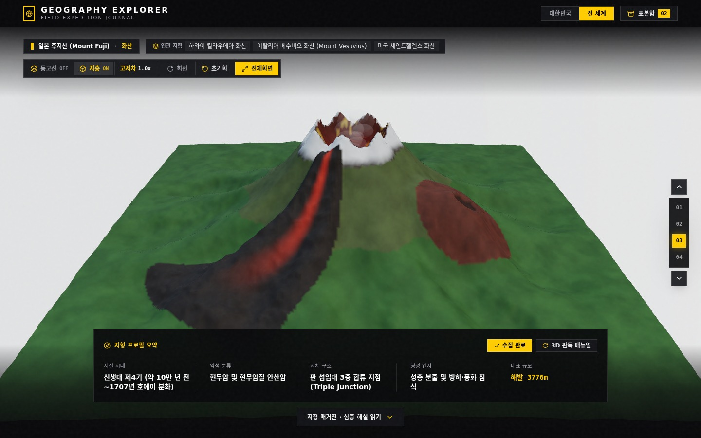
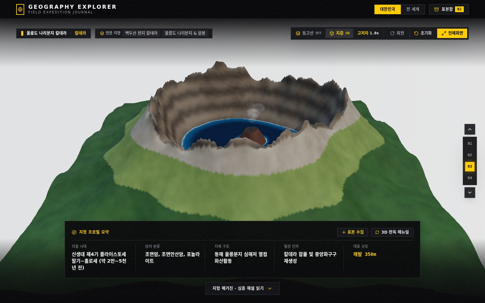
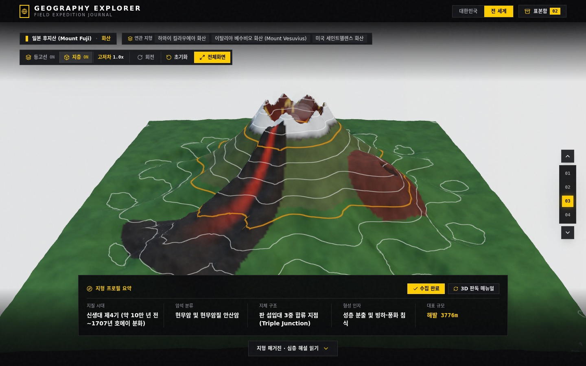
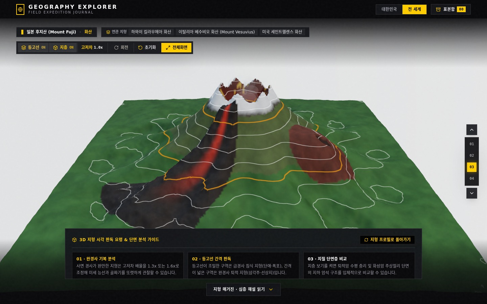

# 📖 지형 탐험가 4단 슬라이드 시각화 가이드 (Slide Visual Guide · v1.4.0)

본 가이드는 지형 탐험가(Geography Explorer v1.4.0)의 **내셔널 지오그래픽 에디토리얼 다크(NatGeo Editorial Dark)** 인터페이스, 4-Act 풀스크린 스냅 슬라이드별 화면 구조, 표본 수집 아카이브(`SpecimenDrawer`), 그리고 3D 디오라마·지형 매거진(다크/페이퍼 모드)의 조작 및 판독 방법을 실제 구동 스크린샷과 함께 안내합니다.

---

## 1. 4-Act 풀스크린 내러티브 구조 (4-Act Narrative Flow)

상단 고정 마스트헤드([`Navigation`](../src/components/Navigation.tsx), `56px`) 아래의 `calc(100vh - 56px)` 뷰포트 4개 액트가 CSS Scroll Snap, 부드러운 4차 이징 스크롤([`useSlideNavigation`](../src/hooks/useSlideNavigation.ts)), 그리고 우측 플로팅 챕터 독(`01`~`04`)으로 유기적으로 연동됩니다.

```text
┌────────────────────────────────────────────────────────────────────────────────────────┐
│ [HEADER] ▣ GEOGRAPHY EXPLORER · FIELD EXPEDITION JOURNAL   [대한민국|전 세계] [표본함 02]│
├────────────────────────────────────────────────────────────────────────────────────────┤
│ [SLIDE 01] 메인 커버 (HeroSlideshow)                                                    │
│ 시네마틱 크로스페이드 커버 · 마우스 추적 위상 조리개 · 6대 카테고리 · 34개 UI 지형 태그 │
└───────────────────────────────────────────┬────────────────────────────────────────────┘
                                            │ (Smooth Quartic Ease-Out Snap Scroll)
                                            ▼
┌────────────────────────────────────────────────────────────────────────────────────────┐
│ [SLIDE 02] 구글 위성지도 (GoogleMapSlide)                                               │
│ 100vh Google 위성 뷰 · 직접 조작 락 토글 · NatGeo 옐로우 플래카드 · 연관 명소·표본 수집│
└───────────────────────────────────────────┬────────────────────────────────────────────┘
                                            │ (Smooth Quartic Ease-Out Snap Scroll)
                                            ▼
┌────────────────────────────────────────────────────────────────────────────────────────┐
│ [SLIDE 03] 3D 입체 지형 (Terrain3DSlide + Terrain3D)                                    │
│ 단일 영속 240×240 3D 메쉬 · GLSL 등고선 · 28층 지층 · 고저차 1.0~1.6x · 180° 3D 플립   │
└───────────────────────────────────────────┬────────────────────────────────────────────┘
                                            │ (Smooth Quartic Ease-Out Snap Scroll)
                                            ▼
┌────────────────────────────────────────────────────────────────────────────────────────┐
│ [SLIDE 04] 지형 매거진 (GeologicalGuideSlide + guide/*)                                 │
│ 다크/페이퍼 모드 · 4단계 난이도(초/중/고/일반) · 4단계 연대기 · 핵심개념 · 현장 도감   │
└────────────────────────────────────────────────────────────────────────────────────────┘
```

---

## 2. 전역 마스트헤드, 챕터 독 & 표본 아카이브 (`Navigation` · `SpecimenDrawer`)

### 상단 마스트헤드 (`56px`)
- **좌측 NatGeo 옐로우 마스트헤드 (`GEOGRAPHY EXPLORER · FIELD EXPEDITION JOURNAL`)**: 클릭 시 언제든지 `SLIDE 01` 메인 커버로 복귀하고 6초 자동 슬라이드쇼를 재개합니다.
- **권역 스위처**: `[ 대한민국 ]` (79개소) ↔ `[ 전 세계 ]` (86개소)를 원클릭 전환합니다.
- **표본함 오도미터 버튼 (`표본함 [ 00 ]`)**: 스프링 물리 숫자 휠([`OdometerCounter`](../src/components/kinetic/OdometerCounter.tsx))이 현재 수집된 표본 수를 표시하며, 클릭 시 우측 표본 아카이브 서랍을 엽니다.

### 표본 수집 아카이브 (`SpecimenDrawer`)


- `SLIDE 02`, `SLIDE 03`, `SLIDE 04` 어디서나 표본 수집 버튼([`SpecimenCollectButton`](../src/components/common/SpecimenCollectButton.tsx))으로 현재 명소를 저장·해제할 수 있으며 `localStorage`(`geo_specimens_v1`)에 영구 보관됩니다.
- 서랍 내 `[ 탐색 바로가기 ↗ ]`를 클릭하면 해당 표본의 권역(`korea`/`world`)·카테고리·고유 `id`를 정확히 복원하여 `SLIDE 03` 3D 디오라마로 즉시 이동합니다 (`ESC` 키 또는 우측 상단 `×` 버튼으로 닫기 지원).

### 우측 플로팅 챕터 독 (`SlideNavigationDock`)
- 마우스 클릭 및 키보드 `ArrowUp` / `ArrowDown` / `PageUp` / `PageDown` 단축키로 `01`~`04` 슬라이드 간 즉시 이동할 수 있습니다. 각 번호에 마우스를 올리면 슬라이드 제목과 설명 툴팁이 표시됩니다.

---

## 3. 슬라이드별 상세 레이아웃 및 조작 매뉴얼

### [SLIDE 01] 메인 커버 (`HeroSlideshow`)

```text
┌────────────────────────────────────────────────────────────────────────────────────────┐
│ ▌ EARTH LANDFORM ARCHIVE                                                               │
│                                                                                        │
│         ╭───────╮         ← 시네마틱 크로스페이드 커버 + 마우스 추적 위상 조리개 캔버스 │
│         │  (+)  │           (HeroApertureCanvas · SLIDE 01 활성 시에만 rAF 구동)       │
│         ╰───────╯                                                                      │
│  ▲ 01 · volcanic                                                                       │
│  화산 및 산지 지형                                                                     │
│  지각 변동과 마그마의 활동으로 만들어진 웅장한 지형                                    │
│                                                                                        │
│  [ 화산 → ] [ 기생화산 (오름) → ] [ 칼데라 → ] [ 주상절리 → ] [ 용암동굴 → ] [ 단층 산맥 → ] │
│                                                                                        │
│  [01 화산] [02 해안] [03 하천] [04 카르스트] [05 빙하] [06 건조]   [위성 지도 보기 ▾][❚❚]│
└────────────────────────────────────────────────────────────────────────────────────────┘
```

- **시네마틱 크로스페이드 전환**: 6대 지형 대분류를 6초 간격 자동 전환하거나 하단 썸네일 스트립으로 수동 선택할 수 있습니다.
- **위상 조리개 오버레이 ([`HeroApertureCanvas`](../src/components/kinetic/HeroApertureCanvas.tsx))**: 마우스 포인터 위치에 반응하는 골드 동심원 조리개와 좌표 눈금을 렌더링하며, 비활성 슬라이드에서는 자동으로 일시정지됩니다.
- **34개 세부 지형 태그 버튼**: 원하는 지형 태그를 클릭하면 해당 지형의 대표 명소가 매칭되고 `SLIDE 02` 위성지도로 부드럽게 스크롤 이동합니다.

---

### [SLIDE 02] 구글 위성지도 (`GoogleMapSlide`)

```text
┌────────────────────────────────────────────────────────────────────────────────────────┐
│ [ ▌ 위성 지형 관측 · 전 세계 ]                            [ 위성 지도 직접 조작하기 ]   │
├────────────────────────────────────────────────────────────────────────────────────────┤
│  ┌───────────────────────────────────────┐                                             │
│  │ ═════════════════════════════════════ │ ← 3px NatGeo Yellow Top Accent Bar          │
│  │ 🧭 WORLD ARCHIVE                 화산 │                                             │
│  │ 하와이 킬라우에아 화산                │   [ 100vh Google Satellite Map (t=k&z=13) ] │
│  │ "태평양 열점 위에서 끓어오르는..."    │                                             │
│  │ 형성 원리                             │                                             │
│  │ [ 탐사 지역 ]   |   [ 지질 시대·암석 ] │                                             │
│  │ [ + 표본함에 수집하기 ]               │                                             │
│  │ [Google Maps ↗] [Google Earth 3D ↗]   │                                             │
│  │ 연관 지형: [후지산] [베수비오] ...     │                                             │
│  └───────────────────────────────────────┘                                             │
│                         [ 3D 입체 지형 디오라마 보기 ▾ ]                                │
└────────────────────────────────────────────────────────────────────────────────────────┘
```

- **위성 지도 직접 조작 모드**: 기본 상태에서는 페이지 스냅 스크롤을 방해하지 않도록 지도 인터랙션이 잠겨 있으며(`pointer-events-none`), 우측 상단 `[ 위성 지도 직접 조작하기 ]` 버튼을 켜면 자유롭게 줌·팬할 수 있습니다.
- **외부 공간정보 연계**: `Google Maps`, `Google Earth 3D`, 그리고 대한민국 명소 선택 시 `Naver Map` 바로가기 링크를 제공합니다.
- **연관 지형 바 ([`AlternativePlacesBar`](../src/components/common/AlternativePlacesBar.tsx))**: 동일 지형 분류에 속한 다른 국내외 명소로 즉시 전환할 수 있습니다.

---

### [SLIDE 03] 3D 입체 지형 디오라마 (`Terrain3DSlide` · `Terrain3D`)





#### 상단 3D HUD 컨트롤러
| 컨트롤 | 기능 | 학습 효과 |
|:---|:---|:---|
| **`등고선 [ON/OFF]`** | 표면에 GLSL 골드 계곡선·화이트 주곡선 투영 | 사면 경사와 고도 변화를 직관적으로 판독 (수면 아래는 `aSubmerged`로 자동 마스킹) |
| **`지층 [ON/OFF]`** | 디오라마 4면 벽체에 28층 지질 단면(Strata Skirt) 노출 | 퇴적층리 및 화성암 지하 암석 구조 비교 |
| **`고저차 [1.0x~1.6x]`** | 수직 과장 배율(`1.0x → 1.3x → 1.6x`) 순환 | 순상화산·삼각주·갯벌 등 완경사 지형의 미세 기복 강조 (등고선 밀도 불변 유지) |
| **`회전 / 초기화`** | 360° 턴테이블 자동 회전 토글 / 기본 카메라 위치(`[0, 11.8, 19.6]`) 복구 | 전방위 입체 관찰 및 표준 시점 즉시 복귀 |
| **`전체화면`** | 단일 WebGL 컨텍스트 그대로 풀스크린 확장 (`ESC` 종료) | 전자칠판 및 대형 화면 수업 발표에 최적화 |

#### 실시간 GLSL 3D 등고선 오버레이 (`등고선 ON`)



- 등고선을 켜면 지형 표면에 **골드 계곡선(Index)**과 **화이트 주곡선(Intermediate)**이 셰이더 재컴파일 없이 0ms로 투영됩니다.
- 등고선 간격이 좁은 곳은 급경사 침식면(화구벽·단애·폭포), 넓은 곳은 완경사 퇴적면(삼각주·선상지·범람원)임을 3D 입체 모델 위에서 즉시 확인할 수 있습니다.

#### 하단 180° Y축 3D 플립 카드 (`지형 프로필 요약` ↔ `3D 판독 매뉴얼`)



- **앞면 (`지형 프로필 요약`)**: 지질 시대, 암석 분류, 지체 구조, 형성 인자, 대표 규모 5개 핵심 스펙과 `[ 표본 수집 ]`, `[ 3D 판독 매뉴얼 ]` 버튼 제공.
- **뒷면 (`3D 지형 시각 판독 요령 & 단면 분석 가이드`)**: 클릭 시 카드가 Y축으로 180° 회전하며 `01 · 완경사 기복 분석`, `02 · 등고선 간격 판독`, `03 · 지질 단면층 비교` 3대 현장 판독 가이드를 표시합니다.

---

### [SLIDE 04] 지형 매거진 (`GeologicalGuideSlide` + `guide/*`)

내셔널 지오그래픽 특집 기사 형식의 장문 에디토리얼 매거진 뷰입니다. 최상단 2px 골드 읽기 진행률 바와 [`GuideStickyBar`](../src/components/slides/guide/GuideStickyBar.tsx)가 스크롤 중에도 상단에 고정됩니다.

#### 다크 에디토리얼 모드 — PART I: 4단계 지형 형성 연대기


#### 페이퍼 매거진 모드 (`#F6F3EC` 웜 아이보리) — 초등 난이도 & PART II~III · 현장 도감


#### 매거진 구성 및 핵심 기능
1. **스티키 매거진 리더 바 (`GuideStickyBar`)**:
   - **기사 목차 앵커**: `서문 · 형성과정 · 심층해설 · 현장도감` 4개 섹션으로 원클릭 이동.
   - **4단계 교육과정 난이도 전환 (`초등` / `중등` / `고등` / `일반`)**:
     * **초등**: 초등 교과 수준의 명확하고 직관적인 순화 어휘로 형성 원리와 3가지 지형 비밀 안내.
     * **중등**: 마그마 점성, 침식·퇴적, 용식 등 인과관계 중심 과학 원리 해설.
     * **고등**: 2022 개정 지구과학 I·한국지리/세계지리 성취기준 코드 및 지체구조 심층 분석.
     * **일반**: 심층 시간(Deep Time), 경관 미학, 현장 답사 맥락의 교양 에세이.
   - **다크 / 페이퍼 모드 토글**: 암실·프로젝터 수업에 유리한 **다크 에디토리얼 모드(`#0A0A0C`)**와 장문 독서·인쇄물 감성에 맞춘 **페이퍼 매거진 모드(`#F6F3EC`)** 실시간 전환.
2. **오프닝 스프레드**: 장소별 실제 경관 사진(`FIG. 01`, 전 165개소 Wikimedia Commons 매핑), 드롭캡(`.magazine-drop-cap`) 에디토리얼 요약, 핵심 탐구 질문/성취기준 인용구 박스.
3. **PART I · CHRONOLOGY ([`GuideTimelineSection`](../src/components/slides/guide/GuideTimelineSection.tsx))**: 01~04 시계열 형성 단계를 가로 확장 카드 인터랙션(호버/클릭 시 `flex-[2.4]` 확장)으로 탐색.
4. **PART II · KEY CONCEPTS & PART III · IN-DEPTH REPORT**: 핵심 지형학 개념 3선과 `react-markdown` + `remark-gfm` 기반 심층 지형 형성 보고서 전문.
5. **우측 스티키 현장 도감 ([`GuideFieldDossier`](../src/components/slides/guide/GuideFieldDossier.tsx))**: 지질 프로필 팩트시트, 현장 탐방 관찰 포인트, 위성사진 판독 핵심 지표, 추천 탐방 시기 및 지질 보존·안전 수칙을 본문 독서 중에도 우측에 고정 참조.
