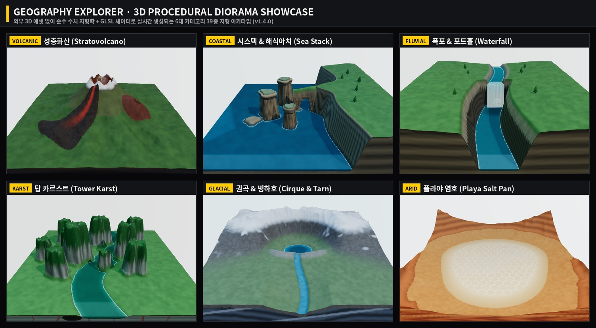
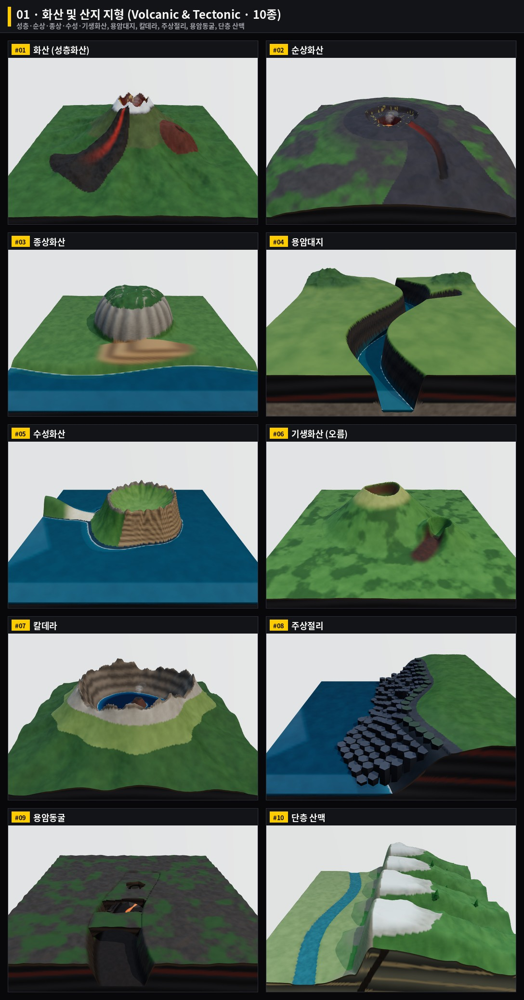
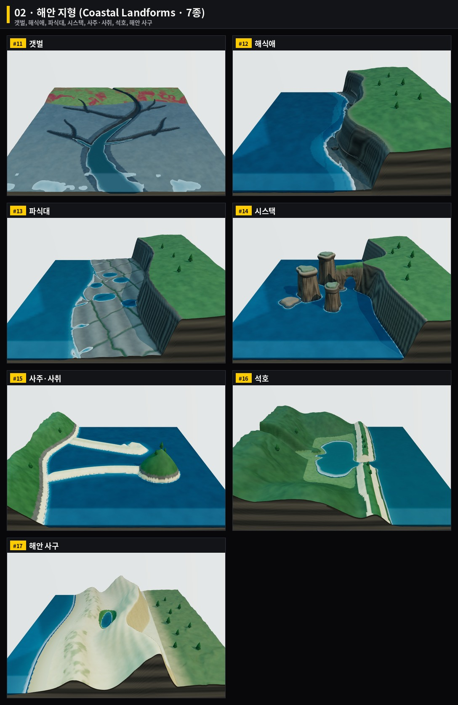
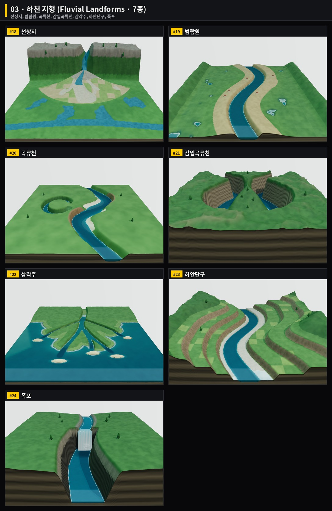
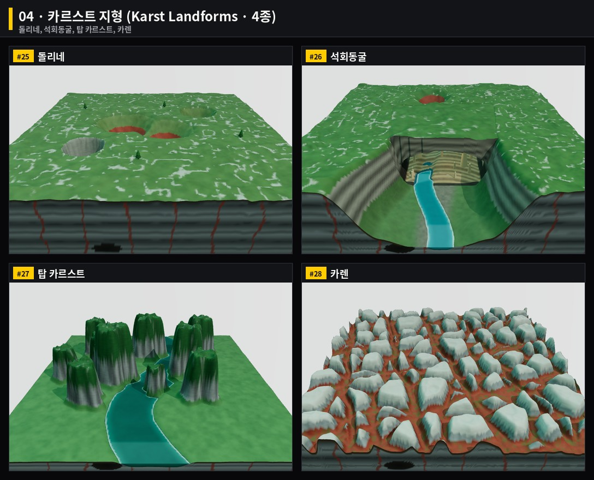
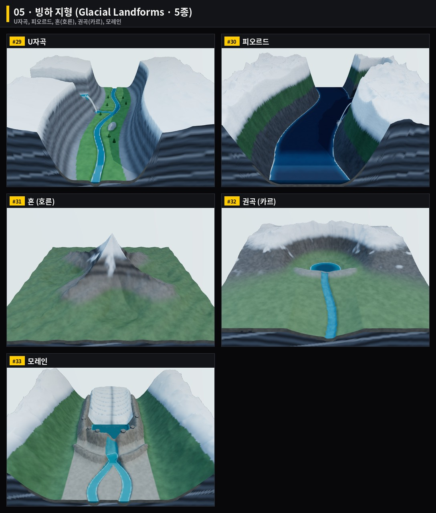
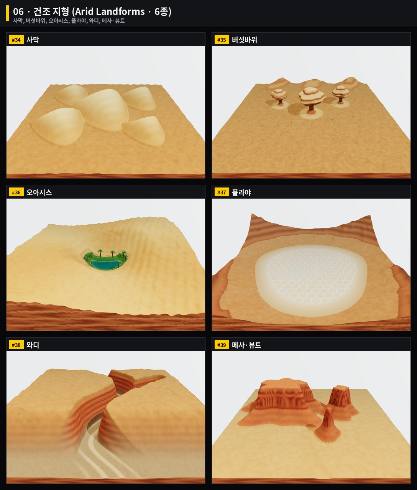

# 🌍 지형 탐험가 지형 총람 및 165개 지질 명소 카탈로그 (Terrain Catalog · v1.4.0)

지형 탐험가(Geography Explorer)는 **6대 대분류**, **34개 UI 지형 태그**, **39종 고유 지오메트리 3D 아키타입**, 그리고 **총 165개(전 세계 86개소, 대한민국 79개소)**의 고유 식별 명소 데이터베이스 및 **165/165 장소별 실제 경관 사진 매핑**을 내장하고 있습니다.

> **v1.4.0 도달성 보장**: 전체 **165개 명소 중 165개(100%)**와 **39종 3D 아키타입 중 39종(100%)**이 UI 태그 및 연관 지형 전환을 통해 빠짐없이 도달 가능하며, 전 아키타입에서 고도 이상치(DEM 스파이크) 0건을 검증했습니다.



---

## 1. 6대 대분류 및 34개 UI 지형 태그 매트릭스

[`TERRAIN_CATEGORIES`](../src/constants/terrains.ts)에 정의된 6대 대분류와 34개 UI 탐색 태그의 전체 구성입니다.

| 대분류 (Category) | 영문 ID | UI 지형 태그 (총 34종) | 명소 수 (세계 / 국내) | 3D 아키타입 | 주요 지형 형성 메커니즘 요약 |
|:---|:---:|:---|:---:|:---:|:---|
| **화산 및 산지 지형** | `volcanic` | 화산, 기생화산 (오름), 칼데라, 주상절리, 용암동굴, 단층 산맥 *(6)* | **33** (16 / 17) | **10종** | 마그마 점성·분출 유형, 냉각 수축 절리, 화도 함몰 및 단층 융기·열점 작용 |
| **해안 지형** | `coastal` | 갯벌, 해식애 (해안 절벽), 파식대, 시스택 (바위섬), 해안 사구, 사주, 석호 *(7)* | **25** (10 / 15) | **7종** | 파랑 침식·퇴적, 연안류 운반, 조석 간만의 차, 후빙기 해수면 변동 |
| **하천 지형** | `fluvial` | 선상지, 범람원, 곡류천, 삼각주, 하안단구, 폭포 *(6)* | **25** (11 / 14) | **7종** | 유수의 하방·측방 침식, 유속 급감에 따른 퇴적, 지반 융기 및 차별 침식 |
| **카르스트 지형** | `karst` | 석회동굴, 돌리네, 카렌, 탑 카르스트 *(4)* | **31** (17 / 14) | **4종** | 약산성 빗물·지하수에 의한 탄산염암 용식($\text{CaCO}_3 + \text{H}_2\text{O} + \text{CO}_2 \rightleftharpoons \text{Ca(HCO}_3)_2$) |
| **빙하 지형** | `glacial` | U자곡, 피오르드, 혼 (호른), 권곡, 모레인 *(5)* | **18** (10 / 8) | **5종** | 빙하 굴식·마쇄 작용, 빙식곡 해수 침수, 빙퇴석 집적 및 주빙하 동결파쇄 |
| **건조 지형** | `arid` | 사막, 버섯바위, 오아시스, 플라야, 와디, 메사·뷰트 *(6)* | **33** (22 / 11) | **6종** | 극심한 일교차 물리적 풍화, 바람 취식·마식·모래 퇴적, 간헐천 및 염호 증발 |

---

## 2. 39종 지오메트리 세부 아키타입 총람 (`terrainRegistry.ts`)

단일 진실 원천(SSOT) 모듈인 [`resolveTerrainKey()`](../src/constants/terrainRegistry.ts)는 34개 UI 태그와 `placeContext`(명소 이름·태그·요약 문맥)를 결합해 **39종의 고유 3D 지오메트리 엔진**으로 정확하게 라우팅합니다.

- `화산` 태그 → 문맥 분기(`VOLCANIC_CONTEXT_RULES`): **성층화산(`화산`)**, **순상화산**, **종상화산**, **용암대지**, **수성화산** 5종 자동 분기
- `곡류천` 태그 → 문맥 분기(`INCISED_MEANDER_CONTEXT`): **자유곡류천(`곡류천`)**, **감입곡류천** 2종 자동 분기
- 39종 중 **35종 아키타입**에는 [`TerrainSpecialMeshes.tsx`](../src/components/terrain/TerrainSpecialMeshes.tsx) 레지스트리를 통해 카테고리별 전용 3D 특수 메쉬(`src/components/terrain/meshes/*.tsx`)가 결합됩니다.

```text
┌────────────────────────────────────────────────────────────────────────────────────────┐
│                      39 PROCEDURAL 3D ARCHETYPES CLASSIFICATION                        │
├────────────────┬───────────────────────────────────────────────────────────────────────┤
│ 화산·산지 (10) │ 화산(성층화산), 순상화산, 종상화산, 용암대지, 수성화산, 기생화산(오름),│
│                │ 칼데라, 주상절리, 용암동굴, 단층 산맥                                 │
├────────────────┼───────────────────────────────────────────────────────────────────────┤
│ 해안 지형 (7)  │ 갯벌, 해식애, 파식대, 시스택, 사주·사취, 석호, 해안 사구             │
├────────────────┼───────────────────────────────────────────────────────────────────────┤
│ 하천 지형 (7)  │ 선상지, 범람원, 곡류천(자유곡류), 감입곡류천, 삼각주, 하안단구, 폭포   │
├────────────────┼───────────────────────────────────────────────────────────────────────┤
│ 카르스트 (4)   │ 돌리네, 석회동굴, 탑 카르스트, 카렌                                   │
├────────────────┼───────────────────────────────────────────────────────────────────────┤
│ 빙하 지형 (5)  │ U자곡, 피오르드, 혼(호른), 권곡(카르), 모레인(빙퇴석)                  │
├────────────────┼───────────────────────────────────────────────────────────────────────┤
│ 건조 지형 (6)  │ 사막, 버섯바위, 오아시스, 플라야, 와디, 메사·뷰트                     │
└────────────────┴───────────────────────────────────────────────────────────────────────┘
```

### 39종 아키타입별 3D 모델링 및 특수 메쉬 명세

#### 화산 및 산지 지형 (10종)
1. **화산 (성층화산)**: 대칭 원추 사면, 정상 만년설·용암 화구, 측면 용암류 채널, 보조 분석구 및 증기 플룸.
2. **순상화산**: 완경사(5°~10°) 현무암질 순상 산체, 광폭 함몰 화구 용암호 및 유동성 용암류.
3. **종상화산**: 점성 높은 조면암·유문암질 돔 융기형 산체와 해안 사면 전이.
4. **용암대지**: 수평 평탄 현무암 대지 정상부와 연속 경사 주상절리 협곡 단애 및 하천 수계.
5. **수성화산**: 마그마-물 폭발로 형성된 환형 응회구(Tuff Cone), 침식 해식애, 육계사주 연결부.
6. **기생화산 (오름)**: 완만한 말굽형 분석구 화구 및 측면 용암 유출구.
7. **칼데라**: 함몰 외륜산 단애, 현수 칼데라호(`aSubmerged` 마스킹), 중앙 화구구 및 분기공.
8. **주상절리**: 다수의 육각 현무암 기둥 클러스터 특수 메쉬와 해식 파랑 수면.
9. **용암동굴**: 전면 절개형 용암 튜브 통로, 천장 붕괴 채광창(Skylight) 및 용암류 특수 메쉬.
10. **단층 산맥**: 비대칭 단층애(Fault Scarp), 삼각말단면, 선상지 전이, 산록 하천 및 알파인 주광 환경.

#### 해안 지형 (7종)
11. **갯벌**: 조간대 완경사 평원, 수지상 S자 조류 수로(갯골), 조수 웅덩이 및 염생식물 군락.
12. **해식애**: 파랑 침식 수직 해안 단애, 해식동, 파식 노치 및 연안 포말선.
13. **파식대**: 만조·간조선 사이 완경사 암반 침식 플랫폼, 절리 균열 및 조수 웅덩이(Tide Pool).
14. **시스택**: 해식애와 분리된 잔류 해상 암주 군락 및 결합형 해식아치 특수 메쉬.
15. **사주·사취**: 연안류 운반으로 돌출된 갈고리형 사취(Hooked Spit)와 섬을 잇는 육계사주(Tombolo).
16. **석호**: 연안 사주와 갯트임(Inlet)으로 외해와 반격리된 해안 호수 수역.
17. **해안 사구**: 해풍이 쌓은 평행 사구 능선, 배후 사구습지(Slack) 및 방풍 식생.

#### 하천 지형 (7종)
18. **선상지**: 산지 곡구(선정)에서 유속 급감으로 펼쳐진 부채꼴 충적선, 망상 수로 및 선단 용천대.
19. **범람원**: 하천 양안의 자연제방(Natural Levee)과 배후습지·소택지 단면.
20. **곡류천**: 자유곡류 하도, 활주사면 포인트바(Point Bar) 및 절단된 초승달 우각호(Oxbow Lake).
21. **감입곡류천**: 지반 융기에 동반된 깊은 협곡 곡류, 원활한 경사 단애 및 침식 사면.
22. **삼각주**: 하구 분기 하도망(Distributary Channels), 저경사 충적 엽상체 및 전방 사주.
23. **하안단구**: 간헐적 지반 융기와 하방 침식이 만든 다단 계단상 단구면 및 하상.
24. **폭포**: 경암 캡록(Caprock) 립, 수직 낙수 수막·포말, 하부 폭호(Plunge Pool) 및 상·하류 이중 수위 마스킹.

#### 카르스트 지형 (4종)
25. **돌리네**: 석회암 용식·함몰 깔때기형 싱크홀, 테라로사 적색 토양 및 우발라(Uvala) 복합 함지.
26. **석회동굴**: 전면 절개형 지하 공동, 종유석·석순·석주, 유석 단구 및 지하 하천 특수 메쉬.
27. **탑 카르스트**: 열대·아열대 용식으로 잔류한 급경사 석회암 탑형 암봉 군락과 사행 하천.
28. **카렌**: 빗물 용식 열극(Grike)과 볼록 암반 능선(Clint), 테라로사 틈새 토양이 교차하는 석회암 노두.

#### 빙하 지형 (5종)
29. **U자곡**: 빙하 굴식이 깎은 평저 U자형 곡벽, 측면 현곡(Hanging Valley) 폭포 및 미스핏(Misfit) 사행 하천.
30. **피오르드**: 빙식곡에 해수가 깊숙이 침입한 급애 협만과 만년설 고원.
31. **혼 (호른)**: 3방향 이상 권곡의 두부 침식이 조각한 피라미드형 첨봉과 예리한 아레트(Arête) 능선.
32. **권곡 (카르)**: 반원형 안락의자 빙식 분지, 중앙 빙하호(Tarn) 및 유출 빙하수 하천.
33. **모레인 (빙퇴석)**: 빙하 설단(Glacier Snout), 측퇴석·종퇴석(Terminal Moraine) 제방, 빙하말단호 및 망상 유출수.

#### 건조 지형 (6종)
34. **사막**: 탁월풍 방향에 정렬된 바르한(초승달) 사구 군락과 풍성 사면 리플.
35. **버섯바위**: 지표 부근 모래 마식(Abrasion)으로 하부 기둥이 가늘어진 언더컷 버섯형 암주 특수 메쉬.
36. **오아시스**: 사구 분지 지하수 용출 초승달 호수, 습지 초지 및 대추야자 식생 군락.
37. **플라야**: 건조 분지 바닥의 초평탄 백색 육각 염각판(Polygonal Salt Crust)과 얇은 브라인 수면 반사.
38. **와디**: 평시 메마른 평저 건조 계곡, 급경사 수평 퇴적층 협곡벽 및 우기 유로 흔적.
39. **메사·뷰트**: 수평 퇴적층의 차별 침식으로 잔류한 탁상형 메사(Mesa), 좁은 뷰트(Butte) 및 첨탑 피너클.

---

## 3. 165개 전수 지질 명소 데이터베이스 및 3D 카탈로그 시트

> 모든 명소는 `src/constants/places/*.ts` 및 `src/constants/placeImages.ts` 소스 코드와 1:1로 일치하며, 165개 전수 고유 `id` 및 100% UI 도달성으로 검증되었습니다.

### [1] 화산 및 산지 지형 (`volcanic.ts`) — 총 33개소 (전 세계 16 / 대한민국 17)



#### 전 세계 명소 (16개소)
1. **하와이 킬라우에아 화산** (`미국 하와이주 하와이섬`) `[화산 → 순상화산]`
2. **일본 후지산 (Mount Fuji)** (`일본 시즈오카현 / 야마나시현`) `[화산 → 성층화산]`
3. **이탈리아 베수비오 화산 (Mount Vesuvius)** (`이탈리아 캄파니아주 나폴리`) `[화산 → 성층화산]`
4. **미국 세인트헬렌스 화산** (`미국 워싱턴주 캐스케이드 산맥`) `[화산 → 성층화산]`
5. **미국 오리건 크레이터 레이크 (Crater Lake)** (`미국 오리건주 캐스케이드 산맥`) `[칼데라]`
6. **탄자니아 응고롱고로 칼데라 (Ngorongoro Crater)** (`탄자니아 아루샤주 동아프리카 지구대`) `[칼데라]`
7. **북아일랜드 자이언트 코즈웨이 (Giant's Causeway)** (`영국 북아일랜드 앤트림주`) `[주상절리]`
8. **미국 와이오밍 데빌스타워 (Devils Tower)** (`미국 와이오밍주 블랙힐스`) `[주상절리]`
9. **미국 하와이 카주무라 동굴 (Kazumura Cave)** (`미국 하와이주 하와이섬`) `[용암동굴]`
10. **미국 그랜드티턴 산맥 (Grand Teton)** (`미국 와이오밍주 잭슨홀`) `[단층 산맥]`
11. **미국 시에라네바다 산맥 (Sierra Nevada)** (`미국 캘리포니아주 동부`) `[단층 산맥]`
12. **멕시코 파리쿠틴 화산 (Parícutin Cinder Cone)** (`멕시코 미초아칸주`) `[기생화산 (오름)]`
13. **스페인 테네리페 쿠에바 델 비엔토 (Cueva del Viento)** (`스페인 카나리아 제도 테네리페섬`) `[용암동굴]`
14. **스코틀랜드 스태파섬 핑갈의 동굴 (Fingal's Cave)** (`영국 스코틀랜드 스태파섬`) `[주상절리]`
15. **미국 옐로우스톤 국립공원 슈퍼볼케이노 & 그랜드 프리즘** (`미국 와이오밍주`) `[칼데라]`
16. **탄자니아 응고롱고로 분화구 (Ngorongoro Crater 보존지역)** (`탄자니아 아루샤주`) `[칼데라]`

#### 대한민국 명소 (17개소)
1. **제주 한라산 백록담** (`제주특별자치도`) `[화산 → 순상화산]`
2. **제주 산방산 종상화산** (`제주 서귀포시 안덕면`) `[화산 → 종상화산]`
3. **철원 한탄강 용암대지** (`강원 철원군`) `[화산 → 용암대지]`
4. **제주 성산일출봉 수성화산체** (`제주 서귀포시 성산읍`) `[화산 → 수성화산]`
5. **백두산 천지 칼데라** (`한반도 북부 / 중국 지린성 접경`) `[칼데라]`
6. **울릉도 나리분지 칼데라** (`경북 울릉군 북면`) `[칼데라]`
7. **제주 중문·대포해안 주상절리대** (`제주 서귀포시`) `[주상절리]`
8. **광주 무등산 서석대·입석대** (`광주 동구 / 전남 화순군`) `[주상절리]`
9. **제주 거문오름 용암동굴계 (만장굴)** (`제주 제주시 구좌읍`) `[용암동굴]`
10. **태백산맥 동해안 단층애 (경동지괴)** (`강원 강릉~동해~삼척 일대`) `[단층 산맥]`
11. **울산-경주 양산단층대 구조곡** (`경북 경주 ~ 울산 일대`) `[단층 산맥]`
12. **제주 다랑쉬오름 (월랑봉)** (`제주 제주시 구좌읍 세화리`) `[기생화산 (오름)]`
13. **제주 용눈이오름** (`제주 제주시 구좌읍 종달리`) `[기생화산 (오름)]`
14. **제주 금오름 (검은오름)** (`제주 제주시 한림읍 금악리`) `[기생화산 (오름)]`
15. **제주 용천동굴 (탄산염 석순 복합 용암동굴)** (`제주 제주시 구좌읍 월정리`) `[용암동굴]`
16. **울릉도 나리분지 & 알봉** (`경북 울릉군 북면 나리리`) `[칼데라]`
17. **한탄강 유네스코 세계지질공원 아우라지 베개용암 & 대교천 현무암 협곡** (`경기 포천·연천 일대`) `[화산 → 용암대지]`

---

### [2] 해안 지형 (`coastal.ts`) — 총 25개소 (전 세계 10 / 대한민국 15)



#### 전 세계 명소 (10개소)
1. **독일·네덜란드 바덴해 (Wadden Sea)** (`독일 / 네덜란드 / 덴마크 북해 연안`) `[갯벌]`
2. **캐나다 펀디만 (Bay of Fundy)** (`캐나다 노바스코샤주 / 뉴브런즈윅주`) `[갯벌]`
3. **아일랜드 모허 절벽 (Cliffs of Moher)** (`아일랜드 클레어주 대서양 연안`) `[해식애]`
4. **호주 그레이트오션로드 12사도 바위 (Twelve Apostles)** (`호주 빅토리아주 포트캠벨`) `[시스택]`
5. **프랑스 필라 사구 (Dune of Pilat)** (`프랑스 지롱드주 아르카숑 만`) `[해안 사구]`
6. **러시아·리투아니아 쿠로니안 사주 (Curonian Spit)** (`리투아니아 / 러시아 발트해`) `[사주]`
7. **미국 매사추세츠 케이프코드 사취 (Cape Cod Hook Spit)** (`미국 매사추세츠주`) `[사주·사취]`
8. **프랑스 노르망디 에트르타 해식애와 해식아치 (Étretat)** (`프랑스 노르망디 해안`) `[해식애 (해안 절벽)]`
9. **호주 그레이트 오션 로드 12사도 바위 (The Twelve Apostles)** (`호주 빅토리아주`) `[시스택 (바위섬)]`
10. **미국 오레곤 해안 듄스 (Oregon Dunes National Recreation Area)** (`미국 오레곤주`) `[해안 사구]`

#### 대한민국 명소 (15개소)
1. **순천만 연안습지 갯벌** (`전남 순천시`) `[갯벌]`
2. **신안 증도 모래·펄 혼합 갯벌** (`전남 신안군 증도면`) `[갯벌]`
3. **부산 영도 태종대 신선바위 해식애** (`부산 영도구`) `[해식애]`
4. **부안 채석강 수성퇴적암 해식절벽** (`전북 부안군 변산반도`) `[해식애]`
5. **백령도 두무진 선대암·형제바위** (`인천 옹진군 백령도`) `[시스택]`
6. **독도 촛대바위 및 삼형제굴바위** (`경북 울릉군 울릉읍 독도리`) `[시스택]`
7. **태안 신두리 해안사구** (`충남 태안군 원북면 신두리`) `[해안 사구]`
8. **진도 신비의 바닷길 (조석 육계사주)** (`전남 진도군 고군면 회동리`) `[사주]`
9. **제주 신양 섭지코지 사주·사취 해변** (`제주 서귀포시 성산읍 고성리`) `[사주·사취]`
10. **부산 태종대 신선바위 해식애와 파식대** (`부산 영도구 전망로 24`) `[해식애 (해안 절벽)]`
11. **변산반도 격포리 채석강 파식대** (`전북 부안군 변산면 격포리`) `[파식대]`
12. **고성 화진포 동해안 최대 천연 석호** (`강원 고성군 거진읍 화포리`) `[석호]`
13. **인천 강화도 남단 여차리 갯벌** (`인천 강화군 화도면 여차리`) `[갯벌]`
14. **부안 격포리 채석강 해식애 & 파식대** (`전북 부안군 변산면 격포리`) `[해식애 (해안 절벽)]`
15. **순천만 갯벌 & 용산전망대 S자 갯골** (`전남 순천시 순천만길`) `[갯벌]`

---

### [3] 하천 지형 (`fluvial.ts`) — 총 25개소 (전 세계 11 / 대한민국 14)



#### 전 세계 명소 (11개소)
1. **미국 데스밸리 배드워터 바하다 (Badwater Alluvial Fan)** (`미국 캘리포니아주`) `[선상지]`
2. **미국 미시시피강 하류 범람원** (`미국 루이지애나주 / 미시시피주`) `[범람원]`
3. **이집트 나일강 삼각주 (Nile Delta)** (`이집트 알렉산드리아 / 카이로 북부`) `[삼각주]`
4. **미국 호스슈 벤드 (Horseshoe Bend)** (`미국 애리조나주 콜로라도강`) `[감입곡류 → 감입곡류천]`
5. **뉴질랜드 라카이아 강 하안단구 (Rakaia River Terraces)** (`뉴질랜드 남섬 캔터베리`) `[하안단구]`
6. **미국 미시시피강 자유곡류천과 우각호 (Oxbow Lake)** (`미국 아칸소·미시시피 경계`) `[곡류천]`
7. **미국 미시시피강 조족상 삼각주 (Bird-foot Delta)** (`미국 루이지애나주 멕시코만`) `[삼각주]`
8. **미국·캐나다 나이아가라 폭포 (Niagara Falls)** (`미국 뉴욕 / 캐나다 온타리오`) `[폭포]`
9. **브라질·아르헨티나 이과수 폭포 (Iguazu Falls)** (`아르헨티나 / 브라질 국경`) `[폭포]`
10. **미국 그랜드 캐니언 국립공원 (Grand Canyon National Park)** (`미국 애리조나주`) `[곡류천 → 감입곡류천]`
11. **짐바브웨·잠비아 빅토리아 폭포 (Victoria Falls / Mosi-oa-Tunya)** (`잠베지강 국경`) `[폭포]`

#### 대한민국 명소 (14개소)
1. **경남 사천 선상지** (`경남 사천시 사천읍 일대`) `[선상지]`
2. **구례 지리산 간전 선상지** (`전남 구례군 간전면`) `[선상지]`
3. **김해 낙동강 삼각평야 범람원** (`경남 김해시 ~ 부산 강서구`) `[범람원]`
4. **부산 낙동강 하구 삼각주 (을숙도)** (`부산 사하구 / 강서구`) `[삼각주]`
5. **영월 동강 어라연 감입곡류** (`강원 영월군 영월읍 거운리`) `[감입곡류 → 감입곡류천]`
6. **영월 청령포 및 방절리 하안단구** (`강원 영월군 영월읍 방절리`) `[하안단구]`
7. **안동 하회마을 화천 감입곡류와 부용대** (`경북 안동시 풍천면 하회리`) `[곡류천 → 감입곡류천]`
8. **순천만 동천·이사천 자유곡류천과 S자 갯골** (`전남 순천시 대대동`) `[곡류천]`
9. **경주 남산 서편 선상지** (`경북 경주시 남산동 일원`) `[선상지]`
10. **정선 동강 귤암리 다단 하안단구** (`강원 정선군 정선읍 귤암리`) `[하안단구]`
11. **제주 서귀포 정방폭포 (해안 직하 폭포)** (`제주 서귀포시`) `[폭포]`
12. **철원 한탄강 삼부연폭포** (`강원 철원군 갈말읍 신철원리`) `[폭포]`
13. **영월 한반도지형 선암마을 감입곡류천 & 포인트바** (`강원 영월군 한반도면`) `[곡류천 → 감입곡류천]`
14. **태백 구문소 감입곡류 하식문 & 석개재** (`강원 태백시 동점동`) `[곡류천 → 감입곡류천]`

---

### [4] 카르스트 지형 (`karst.ts`) — 총 31개소 (전 세계 17 / 대한민국 14)



#### 전 세계 명소 (17개소)
1. **미국 켄터키 매머드 케이브 (Mammoth Cave)** (`미국 켄터키주`) `[석회동굴]`
2. **슬로베니아 포스토이나 동굴 (Postojna Cave)** (`슬로베니아 포스토이나`) `[석회동굴]`
3. **뉴질랜드 와이토모 반딧불이 동굴 (Waitomo Glowworm Caves)** (`뉴질랜드 북섬`) `[석회동굴]`
4. **베트남 퐁냐케방 항손둥 동굴 (Hang Son Doong)** (`베트남 꽝빈성`) `[석회동굴]`
5. **멕시코 유카탄 이킬 세노테 (Ik Kil Cenote)** (`멕시코 유카탄주`) `[돌리네]`
6. **벨리즈 그레이트 블루홀 (Great Blue Hole)** (`벨리즈 라이트하우스 리프`) `[돌리네]`
7. **중국 충칭 샤오자이 톈컹 (Xiaozhai Tiankeng)** (`중국 충칭시 펑제현`) `[돌리네]`
8. **오만 빔마 싱크홀 (Bimmah Sinkhole)** (`오만 무스카트주`) `[돌리네]`
9. **중국 윈난 스린 석림 (Shilin Stone Forest)** (`중국 윈난성 쿤밍시`) `[카렌]`
10. **아일랜드 더 버런 (The Burren)** (`아일랜드 서부 클래어 카운티`) `[카렌]`
11. **마다가스카르 칭기 드 베마라하 (Tsingy de Bemaraha)** (`마다가스카르 서부`) `[카렌]`
12. **중국 구이린 리강 탑 카르스트 (Guilin Li River Karst)** (`중국 광시 좡족 자치구`) `[탑 카르스트]`
13. **베트남 하롱베이 (Ha Long Bay)** (`베트남 꽝닌성 하롱시`) `[탑 카르스트]`
14. **태국 팡아만 제임스 본드 섬 (Ko Tapu / Phang Nga Bay)** (`태국 팡아주`) `[탑 카르스트]`
15. **라오스 방비엥 남송강 탑 카르스트 (Vang Vieng Karst Towers)** (`라오스 방비엥`) `[탑 카르스트]`
16. **슬로베니아 포스토이나 동굴 (Postojna Cave 심층 지질)** (`슬로베니아 포스토이나`) `[석회동굴]`
17. **베트남 퐁냐케방 국립공원 (Phong Nha-Ke Bang National Park)** (`베트남 꽝빈성`) `[탑 카르스트]`

#### 대한민국 명소 (14개소)
1. **단양 고수동굴** (`충북 단양군 단양읍`) `[석회동굴]`
2. **삼척 대이리 환선굴** (`강원 삼척시 신기면 대이리`) `[석회동굴]`
3. **영월 김삿갓면 고씨동굴** (`강원 영월군 김삿갓면 진별리`) `[석회동굴]`
4. **평창 백룡동굴 (천연 탐사형 동굴)** (`강원 평창군 미탄면 마하리`) `[석회동굴]`
5. **문경 굴봉산 돌리네습지** (`경북 문경시 산북면 우곡리`) `[돌리네]`
6. **단양 어상천면 삼태산 돌리네 밭** (`충북 단양군 어상천면`) `[돌리네]`
7. **정선 화암면 몰운리 돌리네 군락** (`강원 정선군 화암면 몰운리`) `[돌리네]`
8. **문경새재 조령산 카렌 (Karren)** (`경북 문경시 문경읍 상초리`) `[카렌]`
9. **단양 도양리 석회암 카렌지대** (`충북 단양군 매포읍 도양리`) `[카렌]`
10. **삼척 덕풍계곡 용소 카렌 노두** (`강원 삼척시 가곡면 풍곡리`) `[카렌]`
11. **영월 선돌 (신선암 탑 카르스트 잔구)** (`강원 영월군 영월읍 방절리`) `[탑 카르스트]`
12. **단양 도담삼봉 (수중 탑 카르스트 잔구)** (`충북 단양군 매포읍 하괴리`) `[탑 카르스트]`
13. **영월 청령포 주변 서강 석회암 탑 카르스트 암봉** (`강원 영월군 방절리`) `[탑 카르스트]`
14. **단양 도담삼봉 카르스트 잔구 (Dodamsambong)** (`충북 단양군 매포읍 하괴리`) `[탑 카르스트]`

---

### [5] 빙하 지형 (`glacial.ts`) — 총 18개소 (전 세계 10 / 대한민국 8)



#### 전 세계 명소 (10개소)
1. **미국 요세미티 밸리 (Yosemite Valley)** (`미국 캘리포니아주 시에라네바다`) `[U자곡]`
2. **스위스·이탈리아 마터호른 (Matterhorn)** (`스위스 체르마트 / 이탈리아 발토르낭슈`) `[혼 (호른)]`
3. **프랑스 피레네 가바르니 권곡 (Cirque de Gavarnie)** (`프랑스 오트피레네주`) `[권곡]`
4. **노르웨이 게이랑에르 피오르드 (Geirangerfjord)** (`노르웨이 뫼레오그롬스달주`) `[피오르드]`
5. **뉴질랜드 밀포드 사운드 (Milford Sound / Piopiotahi)** (`뉴질랜드 피오르드랜드`) `[피오르드]`
6. **캐나다 밴프 모레인 호수 (Moraine Lake)** (`캐나다 앨버타주 밴프 국립공원`) `[모레인]`
7. **스위스 알레치 빙하 측퇴석 (Aletsch Glacier Lateral Moraine)** (`스위스 발레주`) `[모레인]`
8. **네팔 히말라야 아마다블람 (Ama Dablam)** (`네팔 사가르마타 쿰부 히말라야`) `[혼 (호른)]`
9. **스위스 융프라우-알레치 빙하 U자곡 (Aletsch Glacier & Lauterbrunnen)** (`스위스 알프스`) `[U자곡]`
10. **미국 요세미티 밸리 (Yosemite Valley 국립공원)** (`미국 캘리포니아주`) `[U자곡]`

#### 대한민국 명소 (8개소 — 빙식곡 및 한반도 주빙하 유산)
1. **백두산 북사면 빙식곡** (`한반도 북부 / 중국 접경 백두산 북사면`) `[U자곡]`
2. **대구 비슬산 암괴류 (주빙하 돌강)** (`대구 달성군 유가읍`) `[U자곡]`
3. **설악산 공룡능선 (주빙하 첨봉)** (`강원 속초시 / 양양군 / 인제군`) `[혼 (호른)]`
4. **설악산 천불동 계곡 권곡두 (안락암 암벽)** (`강원 속초시 설악동`) `[권곡]`
5. **설악산 공룡능선 및 천불동 주빙하 쇄설암괴 (모레인 유사 지형)** (`강원 설악산 국립공원`) `[모레인]`
6. **도봉산 선인봉·자운봉·만장봉 삼각 피라미드 암봉** (`서울 도봉구 / 경기 의정부시`) `[혼 (호른)]`
7. **지리산 세석평전 & 천왕봉 주빙하 평탄면** (`경남 산청군·함양군 일대`) `[U자곡]`
8. **밀양 만덕산 얼음골 동결파쇄애추 (Miryang Ice Valley)** (`경남 밀양시 산내면`) `[모레인]`

---

### [6] 건조 지형 (`arid.ts`) — 총 33개소 (전 세계 22 / 대한민국 11)



#### 전 세계 명소 (22개소)
1. **나미비아 소수스블레이 & 듄 45 (Sossusvlei)** (`나미비아 나미브-나우클루프트`) `[사막]`
2. **모로코 사하라 사막 에르그 셰비 (Erg Chebbi Dunes)** (`모로코 메르주가`) `[사막]`
3. **칠레 아타카마 사막 달의 계곡 (Valle de la Luna)** (`칠레 안토파가스타주`) `[사막]`
4. **아라비아 룹알할리 사막 (Rub' al Khali)** (`사우디아라비아·오만·UAE·예멘`) `[사막]`
5. **이집트 백사막 국립공원 (White Desert Chalk Mushrooms)** (`이집트 파라프라`) `[버섯바위]`
6. **미국 유타주 고블린 밸리 주립공원 (Goblin Valley)** (`미국 유타주`) `[버섯바위]`
7. **미국 캔자스주 머시룸 록 주립공원 (Mushroom Rock State Park)** (`미국 캔자스주`) `[버섯바위]`
8. **중국 둔황 명사산 월아천 (Dunhuang Crescent Lake)** (`중국 간쑤성 둔황`) `[오아시스]`
9. **페루 이카 와카치나 오아시스 (Huacachina Oasis)** (`페루 이카주`) `[오아시스]`
10. **이집트 사하라 시와 오아시스 (Siwa Oasis)** (`이집트 마트루주`) `[오아시스]`
11. **볼리비아 우유니 소금평원 (Salar de Uyuni)** (`볼리비아 포토시주 다니엘캄포스`) `[플라야]`
12. **미국 캘리포니아 데스밸리 레이스트랙 플라야 (Racetrack Playa)** (`미국 캘리포니아주`) `[플라야]`
13. **나미비아 에토샤 팬 (Etosha Pan)** (`나미비아 에토샤 국립공원`) `[플라야]`
14. **미국 유타 보너빌 솔트 플랫 (Bonneville Salt Flats)** (`미국 유타주 웬도버`) `[플라야]`
15. **미국 모뉴먼트 밸리 (Monument Valley)** (`미국 유타·애리조나 나바호 네이션`) `[메사·뷰트]`
16. **미국 유타 캐니언랜즈 아일랜드 인 더 스카이 (Island in the Sky Mesa)** (`미국 유타주`) `[메사·뷰트]`
17. **베네수엘라 로라이마산 테푸이 (Mount Roraima Tepui)** (`베네수엘라·브라질·가이아나 기아나 고지`) `[메사·뷰트]`
18. **요르단 와디 럼 (Wadi Rum)** (`요르단 아카바주 남부`) `[와디]`
19. **오만 와디 바니 칼리드 (Wadi Bani Khalid)** (`오만 하자르 산맥`) `[와디]`
20. **나미비아 피시 리버 캐니언 (Fish River Canyon)** (`나미비아 카라스주 남부`) `[와디]`
21. **볼리비아 우유니 소금사막 (Salar de Uyuni 고원 전경)** (`볼리비아 안데스 알티플라노`) `[플라야]`
22. **칠레 아타카마 사막 달의 계곡 (Valle de la Luna / Atacama 협곡)** (`칠레 산페드로 데 아타카마`) `[와디]`

#### 대한민국 명소 (11개소 — 해안사구, 풍화 버섯바위 및 건조 유사 지형)
1. **태안 신두리 해안사구 (한국의 사막형 모래언덕)** (`충남 태안군 원북면 신두리`) `[사막]`
2. **신안 우이도 돈목해변 풍성사구 (모래산)** (`전남 신안군 도초면 우이도리`) `[사막]`
3. **대구 달성 옥연지 하중도 사구 모래톱** (`대구 달성군 옥포읍 기세리`) `[사막]`
4. **울릉도 남양리 통구미 버섯바위** (`경북 울릉군 서면 남양리`) `[버섯바위]`
5. **부안 변산반도 채석강 버섯형 파식괴** (`전북 부안군 변산면 격포리`) `[버섯바위]`
6. **제주 한림 귀덕리 해안 풍화 버섯바위** (`제주 제주시 한림읍 귀덕리`) `[버섯바위]`
7. **태안 신두리 두웅습지 (사구 오아시스 습지)** (`충남 태안군 원북면 신두리`) `[오아시스]`
8. **제주 선흘리 동백동산 곶자왈 먼물깍 (화산 오아시스 습지)** (`제주 제주시 조천읍`) `[오아시스]`
9. **순천만 갯벌 건조 염각판 (여름철 건열 플라야)** (`전남 순천시 순천만 습지`) `[플라야]`
10. **부안 곰소 천연 증발 염판 대지** (`전북 부안군 진서면 곰소리`) `[플라야]`
11. **태안 신두리 해안사구 (Taean Sinduri Sand Dunes)** (`충남 태안군 원북면 신두리`) `[사막]`
